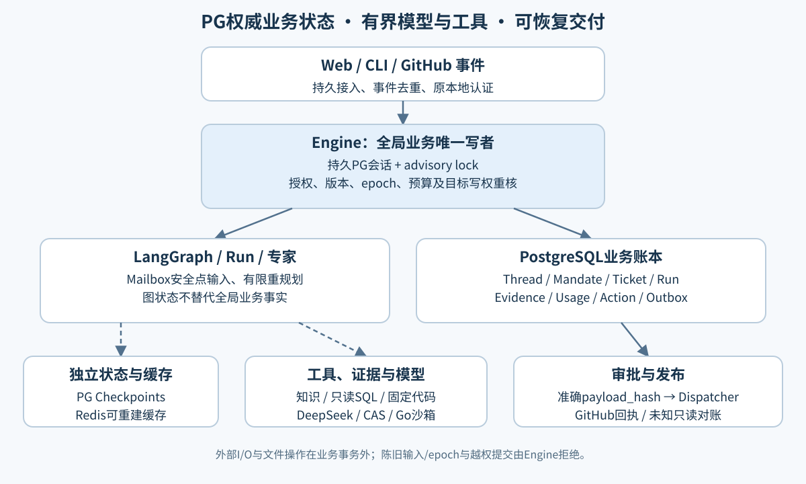

# MGAR V3.5 · 持续研发 Agent

**网页使用入口已统一：启动后打开首页，填写 GitHub 仓库 URL 和问题，即可在同一页提交真实分析、查看执行过程和继续追问。首次打开创建管理员账户，模型凭据与使用许可直接在网页弹窗填写。[单页 Agent 使用说明](v3/docs/agent-ui.md)。**

分析默认按 Token 和费用预算自动推进，无需设置调用轮数；未满足验收要求时继续补查，
并实时流式显示报告草稿。后台处理限流、重复读取和无进展循环，刷新后可恢复执行视图。

[Harness 升级任务书与路线](v3/docs/harness-v4/README.md)：基于当前代码和官方 Codex、
Claude Code、DeepSeek Harness 资料，列出 19 张升级卡、依赖和验收标准；状态为规划，尚未实施。

[Super-Agent 落地任务书](v3/docs/super-agent-v1/README.md)：承接 Harness 规划，提供
飞书/GitHub 持续接入、Router–Worker、静默修复、原会话反馈、常驻部署和验收的 25 张任务卡；状态为规划。

面向 GitHub 工单的事件驱动研发 Agent 原型，支持持续调查、跨知识库／SQL／代码取证、受限函数修复，以及经过人工审批的可恢复交付。

V3.5 把“自然语言任务 → 固定 Commit 只读调查 → Finding/Evidence → 有授权修复 → 测试回执 → Review Bundle → 受控 Draft PR”收敛成一条可复核链路：PostgreSQL 是唯一事实源，外写必须经过 Action/Approval/Outbox，`fixture` 与 `live` 门禁严格分开。

项目重点是让模型调用、任务状态、工具证据和外部写入形成可追溯的工程闭环。底层使用 DeepSeek；任务协调、授权、预算、判定与恢复由应用实现。

**[V3.5 产品说明](v3/docs/v35/PRODUCT.md) · [90 秒演示](v3/docs/v35/DEMO.md) · [评测索引](v3/docs/v35/EVALUATION_INDEX.md) · [完整技术报告](v3/docs/TECHNICAL_REPORT.md) · [本地运行](v3/README.md) · [文档导航](v3/docs/README.md)**

## V3.5 当前能力

| 能力 | 实现与边界 | 入口 |
|---|---|---|
| 只读调查 | 固定 Commit，GitHub 只读 MCP，证据绑定 URI/行号/内容哈希 | Web `/repo`、`mgar repo-analyze` |
| 真实修复 | `RepairHandoff → 结构化 PatchPlan → R02 Worktree → R03 Docker（network none、非 root）` | Workbench、E01 Harness |
| 审查与审批 | 完整 Diff 审查后才可审批；审批绑定 `payload_hash/tree_hash/diff_sha` | Web `/workbench`、`mgar workbench` |
| 受控发布 | Draft PR 三步回执（分支/提交/PR）；未知结果只读对账，禁止重试 | `scripts/r5_demo.py`（fixture MCP） |
| 跨阶段经验 | M01 记忆闭环 + M02 Compaction 不变量，权限与证据不得被压缩丢失 | 自动 |
| 评测与安全 | E01 Harness、E02 四臂消融、E03 35 条安全/灾备场景 | [评测索引](v3/docs/v35/EVALUATION_INDEX.md) |

| 版本 | 新增能力 |
|---|---|
| V3.2 | GitHub 仓库只读分析（Reason → Tool Call → Observation） |
| V3.3 | 本地工作区扫描、Finding 生命周期、缺陷验证器与记忆 schema |
| V3.4 | 受限 Go 修复、固定 Docker 沙箱、R05 Draft PR 骨架、Workbench 统一 API |
| V3.5 | 统一契约与状态机、真实 Handoff/补丁/多轮编排、Outbox 发布、Web/CLI 同一视图、E01-E03 评测与安全门 |

**门禁状态（必须分开理解）**：V3.5 工程门与安全门 `PASS`；E02 真实 live 四臂全部 `PATCH_TRUNCATED`，因此 `live_model_gate`、`live_agent_gate` 为 `FAIL`，结论 `INCONCLUSIVE`；真实 GitHub 写入未执行，`live_github_write_gate=NOT_RUN`。工程门通过不等于真实 Agent 能力通过。

```bash
cd v3
make demo          # 单任务 adversarial fixture 评测（真实 Docker，零付费）
make demo-repo     # 生成固定 Commit 示例仓库与缺陷说明
```

## V3.1 / P0 历史状态

截至北京时间2026-11-07：电商“研巡”的两项P0已完成固定合成场景内的实施与验收，包含Case工单、跨源调查到独立修复的交接，以及业务判定和执行/审批/交付四维状态。真实调查与修复提案通过，三份获批Draft PR已完成远端核对：[#3](https://github.com/Loz888/MAGR-v3/pull/3)、[#4](https://github.com/Loz888/MAGR-v3/pull/4)、[#5](https://github.com/Loz888/MAGR-v3/pull/5)，均未合并；其他P1/P2改进按用户范围不开展。

| 内容 | 最新证据 | 适用范围 |
|---|---|---|
| 三臂真实模型评测 | A **30/30**、B **28/30**、C **29/30**，合计 **87/90** | 30个冻结任务×3配置，开发者可见的修复回归；原三项FAIL保留 |
| E/F协调复验 | 路由各 **36/36**；正常E **7/8**、F **8/8**；负例各12/12 | 固定合成负载，单候选准入；E一项Worker引用失败保留 |
| E/F最新工程验收 | **98项通过**，0失败/错误/跳过 | 真实PG/Redis/LangGraph，受控模型；与历史测试有重叠 |
| 部署与故障恢复 | 独立Linux/systemd虚拟机范围PASS | 整虚拟节点强杀、重启、PG/角色/CAS恢复；生产HA未验收 |
| P0工程 | 最新复验专项 **13项**、原P0回归 **30项**均通过 | 当前源码指纹一致；原404项全量回归保持其历史指纹与范围 |
| P0真实复验 | 正常调查/修复提案各 **3/3**；负例 **2/2**正确处理；真实Draft PR **3/3** | 真实DeepSeek、公开GitHub固定源码、真实SQL及Go沙箱；过期证据追加复验，原提案哈希不变 |

单Agent在该三臂题集中表现最好，尚未建立多Agent优势。以上数字属于不同实验，不能合并成一个通过率。P0原实验新增9次模型调用、保守US$0.001635；本次发布前复验与交付新增调用/费用均为0，累计759次、US$0.313148，未知/预占均为0。费用是峰值价格上界核算，非供应商精确发票。

## 架构



- **PostgreSQL权威状态**：Engine通过持久会话与advisory lock管理全局业务写入；Thread、Mandate、Ticket、Run、Assignment分别建模。
- **LangGraph任务编排**：单Run内执行调查、验证和补证据；Mailbox在安全点接入后续消息，输入版本和execution epoch拦截陈旧执行。
- **跨源证据**：知识快照、中文混合检索、只读SQL和固定GitHub源码；引用绑定实际读取、权限、内容哈希及定位。
- **可控交付**：受限Go函数补丁经AST检查、Docker沙箱和独立测试；完整提案按准确hash审批，经Action/Outbox/Dispatcher发布。
- **恢复与预算**：已结算有效模型结果可复用；未知调用/远端写保留账目并对账；Watchdog只提交受限恢复建议。

## 已实现的能力

| 能力 | 实现与边界 | 阅读入口 |
|---|---|---|
| 持续工单 | Web/CLI/GitHub入口、Mailbox、暂停/取消/恢复、版本化输入 | [R2设计](v3/docs/adr/0002-r2-mailbox.md) |
| 受限路由与多任务 | 已订阅消息直达，冷启动有界路由；模型提案由Engine重核 | [R3设计](v3/docs/adr/0003-r3-router.md) |
| 跨源调查 | 知识/代码专家、受限orders单表SQL、引用验证、已确认摘要 | [R4真实对照](v3/docs/r4-live-report.md) |
| 代码修复 | 一个获准Go纯函数体，隔离测试，完整补丁审批与Draft PR | [R5真实闭环](v3/docs/r5-live-report.md) |
| 巡检与恢复 | 心跳、依赖/积压观察、有限只读策略、未知结果停止 | [R6运行说明](v3/docs/r6-runbook.md) |

“研巡”已经把这些能力接入电商营收核账工单：三个注册模板、只读调查Run、独立修复Run、不可变业务结果、准确提案审批及四维工作台。金额由实际SQL行和Decimal重算，模型选择完整引用并生成受限Go函数体。见[运行手册](v3/docs/p0-commerce-runbook.md)与[完整提案](v3/docs/repairs/P0-20261106/draft-pr-review.md)。

## 技术栈

Python 3.12 · FastAPI / Pydantic · LangGraph / PostgreSQL Checkpoint · PostgreSQL 16 / pgvector · Redis · MCP · DeepSeek · Docker / Go · Linux / systemd

中文检索采用BM25、300维预训练词向量、RRF与成对线性重排。Python依赖由[uv.lock](v3/uv.lock)锁定，容器及MCP/检索模型固定版本或摘要；详见[技术选型与版本](v3/docs/TECHNICAL_REPORT.md#technology)。

## 快速启动

前提：Git、Make、uv、Python 3.12、可用的Docker Engine及Compose V2。Windows用户先完成[WSL2说明](v3/README.md#wsl2-首次启动)。首次运行会下载锁定依赖和容器镜像。

```bash
git clone https://github.com/Loz888/MAGR-v3.git
cd MAGR-v3/v3
uv python install 3.12
make setup
make deps-up
make migrate
make doctor
make dev
```

在确认上一步成功后执行下一步。打开`http://127.0.0.1:18080`，首次创建管理员账户。登录后在模型设置中填写凭据、范围和预算，保存后即可提交真实分析；缺配置时页面会自动引导。CLI 默认的 fixture 演示不调用付费模型，也不发布 GitHub 业务结果。

`/workspace/MAGR-v3`是开发云环境路径，本机应进入自己的克隆目录。停止依赖使用`make deps-stop`，保留数据卷。完整命令、演示与故障处理见[应用README](v3/README.md)。

## 结果、问题与复现

- [三臂最终结果与原三项失败](v3/docs/repairs/R6-20261103/README.md)：数值计算、输出契约、权限判定及受限修复的多轮失败与修复。
- [D/E/F首轮完整报告](v3/docs/experiments/coordination-v1/README.md)：D7/8、E1/8、F4/8；失败与级联输入问题原样保留。
- [E/F修复后报告](v3/docs/experiments/coordination-v2/README.md)：E7/8、F8/8；F相对E的Router调用32→12，减少62.5%，其中16次来自订阅直达、4次来自批处理。
- [E/F修复档案](v3/docs/repairs/COORD-20261106/README.md)：11项非法初始提案、事务重核、有界纠正、真实SIGKILL恢复与剩余Worker问题。
- [独立VM部署与恢复](v3/docs/repairs/R6-HOST-20261105/README.md)：实际环境、失败过程、恢复断言与范围。

本项目保留失败、NOT_RUN、原始分母、冻结manifest及来源哈希。公开库包含合成输入、输出、脱敏回执和索引；密钥、DSN、私有授权、原始账单/数据库备份不公开。详细方法、限制与经验见[完整技术报告](v3/docs/TECHNICAL_REPORT.md)。

## 仓库导览

```text
v3/src/mgar_v3/   Engine、图、工具、路由、修复、恢复及评测实现
v3/web/           现有本地任务工作台
v3/migrations/    26 个显式产品迁移（V3.5 至 0026）
v3/tests/         工程测试；真实PG/Redis，受控模型与外部远端
v3/eval/          冻结题集、独立判定与公开实验结果
v3/experiments/   V3.5 评测数据集（固定 Commit 快照、公开/隐藏/标准补丁）
v3/docs/v35/      V3.5 架构契约、任务卡、验收记录、演示与评测索引
v3/docs/          技术报告、ADR、实验、修复档案与P0设计
v3/deploy/        依赖容器、systemd与隔离VM验收资产
v31-upgrade/     增量任务卡与带时间范围的历史状态
```

历史阶段记录保留在[任务队列](v31-upgrade/TASK_QUEUE.md)与[旧版首页](https://github.com/Loz888/MAGR-v3/blob/2155556cb1c1288f08b5b3abebe55f2a7112253d/README.md)。当前项目介绍以本页和技术报告为入口，历史文件中的状态按其记录时间理解。
