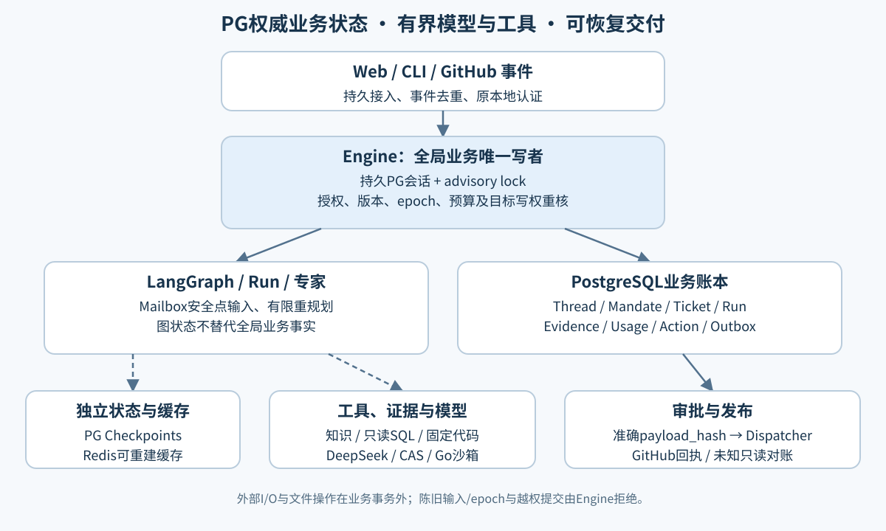
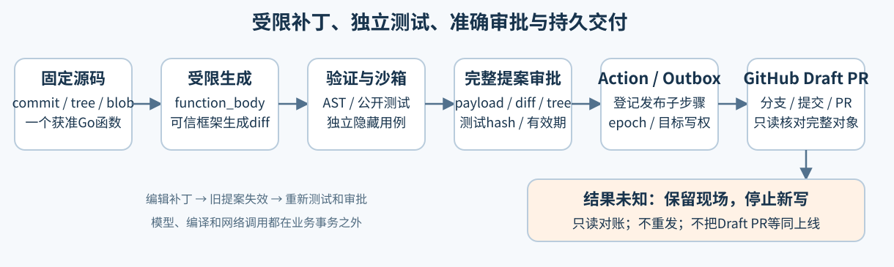

# MGAR V3.1 完整技术报告

事件驱动持续研发Agent：技术选型、架构、真实评测、失败修复与业务产品设计

版本：2026-11-06-public-v1。日期按Asia/Shanghai。整理基线：`2155556cb1c1288f08b5b3abebe55f2a7112253d`；E/F执行代码冻结于`ff6353d`，三臂v6冻结于`c5ca75c`。本轮只整理文档和GitHub页面，没有新增模型调用、业务Issue/评论/PR或部署。

[项目首页](../../README.md) · [文档导航](README.md) · [PDF](reports/20261106/MGAR-V3.1-Technical-Report.pdf) · [独立HTML](reports/20261106/MGAR-V3.1-Technical-Report.html) · [事实与来源索引](reports/20261106/report-data.json)

## 阅读目录

1. [项目目标与当前范围](#overview)
2. [技术选型与锁定版本](#technology)
3. [架构与权威边界](#architecture)
4. [持续任务、路由与输入版本](#continuity)
5. [跨源调查、检索与证据判定](#evidence)
6. [代码修复、审批与交付](#repair)
7. [预算、恢复与独立部署](#operations)
8. [实验设计与全部主要结果](#experiments)
9. [困难、错误与对应解决过程](#incidents)
10. [仅完成设计的两项P0](#p0)
11. [复现、验证及源码导航](#reproduction)
12. [剩余限制与工程经验](#limitations)
13. [主要证据](#references)

<a id="overview"></a>
## 1. 项目目标与当前范围

MGAR V3.1探索如何让大模型参与持续研发任务：接收GitHub工单或本地请求，读取知识、数据库和代码，保留来源证据，提出受限补丁，并在审批后可靠交付。核心目标包括任务连续性、授权边界、执行一致性、可追溯结果及故障恢复。

DeepSeek官方API承担推理，项目实现应用层Agent运行时。基础模型未训练或微调；检索使用预训练中文词向量及独立学习的轻量重排参数。系统中的多Agent是有界协作结构，包含单Run内专家和实验协调器，具体边界由不同评测分别说明。

代码当前具有调查、持续工单、受限Router、跨源工具、纯函数修复、审批发布、监控与恢复能力。三个层面的状态需要分别读取：

| 层面 | 已有成果 | 结论范围 |
|---|---|---|
| 工程实现 | R0–R6核心及注册验收；最新E/F专项98项通过 | 不同历史快照测试有重叠，不能相加成当前全量成绩 |
| 真实实验 | R1评论、R4跨源对照、R5 Draft PR恢复、R6三臂及D/E/F对照 | 使用真实模型/工具和自有合成资料，保留失败 |
| 业务产品 | “研巡”电商工单闭环、统一业务结果判定 | 两项P0设计完成，运行代码/表/API尚未实施 |

当前已通过的R6发布门禁适用于用户批准的独立Linux/systemd虚拟机。P0业务设计不改变旧R6状态。用户已指定其余P1/P2改进不开展，因此本报告记录这些边界，不启动新的改造或实验。

<a id="technology"></a>
## 2. 技术选型与锁定版本

以下Python版本来自当前uv.lock；基础服务与实际解释器版本来自已有验证记录。它们是可核对的项目版本，不表示本轮重新安装或运行了全部组件。

| 技术 | 项目版本/配置 | 用途与选择理由 |
|---|---|---|
| Python | 3.12系列，已验证3.12.14 | 异步API、模型/工具生态、严格类型与评测脚本 |
| FastAPI / Uvicorn | 0.162.0 / 0.54.0 | 本地API、任务工作台后端、SSE、CLI共用Engine |
| Pydantic | 2.14.2 | 严格请求/响应契约、禁止额外字段、授权profile哈希 |
| LangChain / LangGraph | 1.4.7 / 1.2.19 | 模型适配、Run内状态图、专家分支与恢复 |
| PostgreSQL Checkpoint | 3.2.0 | 官方PostgresSaver保存图状态，与业务账本分开 |
| PostgreSQL / pgvector | 已验证16.12 / 0.8.1 | 权威业务状态、短事务、约束、向量检索；产品17个显式迁移 |
| psycopg | 3.3.6 | 持久Engine会话、事务与池；checkpoint另用官方连接机制 |
| Redis | 客户端7.4.1，服务端7.4.7 | 可重建缓存、限流与来源缓存观察，不承载业务权威 |
| MCP | Python SDK 1.30.0，GitHub服务端v2.0.3 | 受限知识/数据/代码工具，读写凭据和工具组隔离 |
| DeepSeek | 官方chat/completions；已冻结实验模型deepseek-flash | 结构化调查、专家综合、受限函数体或路由候选选择 |
| SQLGlot | 27.14.0 | 解析并白名单检查受限PostgreSQL SELECT语法 |
| 中文检索 | jieba 0.42.1、BM25、pgvector、300维词向量、RRF、成对线性重排 | 本地混合召回与排序，参数/资料版本可冻结 |
| 文档与HTTP | pypdf 6.21.4、httpx 0.28.1 | PDF文本提取、受控HTTP调用及回执留存 |
| Docker / Go | 固定沙箱镜像及可信AST工具 | 编译执行受限补丁，隔离候选代码与宿主凭据 |
| Linux / systemd / QEMU | 独立Debian12/Linux6.1测试VM，QEMU TCG | 服务用户、部署、整虚拟节点重启及备份恢复 |
| 工程工具 | uv.lock、pytest 9.2.0、ruff 0.17.3、mypy 1.20.2 | 可重复依赖、注册验收、类型与风格检查 |

技术选择的核心是明确每个组件的责任。PG维护业务事实，LangGraph维护Run内部控制流，Redis缓存可失效信息，模型提出内容或候选，可信代码校验范围和事实。原生HTML/CSS/JavaScript工作台通过API/SSE展示原业务状态，本项目没有依赖新的前端框架来承担状态权威。

依赖依据：[pyproject.toml](../pyproject.toml)、[uv.lock](../uv.lock)、[验证版本](versions.md)、[容器配置](../deploy/compose.yaml)、[GitHub MCP锁](../config/github-mcp-lock.json)、[检索模型锁](../config/rag-model-lock.json)。

<a id="architecture"></a>
## 3. 架构与权威边界



### 3.1 业务对象分离

| 对象 | 含义 | 设计作用 |
|---|---|---|
| Thread | GitHub Issue等外部会话 | 接收事件和维护消息序号；不等于一次执行 |
| Mandate | actor、project、repository、工具/操作范围及模式 | 将用户意图与可用权限固化 |
| Ticket | 一份工作项 | 管理开放/结束和Run归属 |
| Run | 具体执行尝试 | 绑定图版本、输入版本、epoch、结果和预算 |
| Assignment | Run内有限专家任务 | 限制角色、输入和可读来源，不给予全局调度权 |
| Action | 准备对外执行的准确动作 | 固定目标、payload_hash、输入版本、期限与写权 |
| Outbox | 已批准动作的派发记录 | 记录发送、回执、未知和对账进展 |

这种分离使同一Issue的后续消息不必创建完全无关的任务，也使调查权限、补丁权限和发布权限可以分别校验。一个Thread最多一个active primary，observer/context链接不继承对其他Run的写权限。

### 3.2 单写者与事务

Engine的持久PG会话持有advisory lock，所有全局业务与实验元数据写入使用该连接和短事务。连接丢失后原执行不再拥有写入权；不能另开连接绕过锁。checkpoint属于图状态，官方PostgresSaver可以使用独立连接/schema，它不推进全局业务事实。

网络请求、文档解析、嵌入、来源文件/CAS读写、Docker编译都在业务事务之外完成。提交时重新核对输入revision、execution epoch、scope及目标写权。先写不可变Artifact再提交数据库引用；失败可以留下未引用文件，不能留下已发送但未登记的本地业务意图。

PG约束还负责唯一事件、Mailbox序号、一个active primary及稳定预算记录。工程接受以真实PG为基础，没有用SQLite替代并发与事务验收。

### 3.3 三层状态

图checkpoint、业务账本、远端GitHub对象各自有提交边界。图恢复先读取Engine事实，不能凭checkpoint重复推进副作用；远端写与本地事务无法原子提交，使用Outbox和未知结果对账收束不确定性。项目不宣称跨系统exactly-once。

设计依据：[ADR0001](adr/0001-v31-boundaries.md)、[R2](adr/0002-r2-mailbox.md)、[R5](adr/0007-r5-repair-boundaries.md)。

<a id="continuity"></a>
## 4. 持续任务、路由与输入版本

### 4.1 Mailbox与安全点

CLI/Web/GitHub事件经过统一入口持久化。相同source/external_event_id及相同payload返回原回执；同键异内容拒绝。已订阅消息直达primary Mailbox，冷事件进入有限路由队列。

Run在调查/验证/工具节点后的安全点执行intake：先保存不可变输入快照，再由replan确认消费游标。快照、checkpoint和确认不是一个分布式原子事务，因此节点重入必须幂等。原始question保留，追加内容进入新输入版本。新输入会使未发送的旧提案失效，新提案需要新hash审批。

R2边界包括：最多三个用户输入版本（初始加两次replan）、Mailbox 64条/64KiB、快照64KiB、过期输入明确阻塞。长只读任务有持久job和lease，在线程执行后由Engine登记结果；API与控制循环继续响应。

### 4.2 epoch与控制

暂停/取消先持久化并提高execution epoch；旧Worker的迟到结果在提交处被拒绝。恢复沿用原授权、预算和已知结果，不撤销已经发出的远端写。取消后的晚到回执只记录事实，不能恢复任务或自动发布。

### 4.3 两种路由实现的范围

产品R3 Router处理受限冷启动、澄清、控制与任务关联，输出候选提案，不持有调查/发布工具。Engine按批次冻结的Thread revision、Run epoch、Mandate、policy和上下文重核。已有订阅与显式命令走确定性路径。

D/E/F是独立实验协调准入适配器。v1让模型自由产生action和Run UUID，暴露初始错误；v2改为可信代码从公开PG快照生成合法候选，模型只回选event_key/candidate_id。目标留在服务端绑定，并在同一SQL事务中检查Issue、Run、epoch、revision和当前actor后ingest。

v2的固定负载每个事件只有一个合法候选，效果主要来自软件约束。实验适配器提示与产品冷启动Router不同，不能用这份实验替代产品复杂语义路由评测。

依据：[R3 ADR](adr/0003-r3-router.md)、[候选契约ADR](adr/0015-coordination-candidate-contract.md)、[协调源码](../src/mgar_v3/coordination_eval/)。

<a id="evidence"></a>
## 5. 跨源调查、检索与证据判定

### 5.1 知识库与检索

文档先保存原始Artifact和入库任务，解析/嵌入在业务事务外执行；全部成功后用CAS检查发布active snapshot，失败不切换索引。查询先按project/repository/actor/ACL/snapshot过滤，再做BM25、向量召回、RRF融合和学习重排。

本地向量由zh_core_web_md 3.8.0的中文预训练词向量取平均，形成300维L2归一化向量。重排为独立训练并冻结的pairwise linear模型。训练/测试问题及参数摘要留档；fixture向量的协议检查与真实本地检索效果分列。

Redis命中只返回可重建引用，读取时重新检查当前权限。来源撤权影响旧快照引用和缓存。摘要记忆必须经用户确认准确hash，不能把任何模型总结直接写成可信事实。

### 5.2 受限SQL与真实代码

SQL只连接注册的本地只读角色/schema，限制到orders单表与允许的SELECT AST节点；禁止越权表/函数、写操作和不受控语法，限制行数、字节、参数和执行时间。实际结果保存列类型OID、单元格值、查询和观察回执。

GitHub证据固定到commit、tree、blob及字节hash。MCP只读/发布工具组分离，工具能力由Engine针对Run/epoch/task/role签发，模型不能自报身份。真实MCP返回结构按协议解析，不能假定总是纯文本。

### 5.3 事实、计算与独立判定

机械Verifier核对实际读取、本Run/assignment归属、当前ACL、来源hash、定位、引用原文及typed SQL cell。数值任务在实际读取行上用Decimal计算，并用SQL count/sum/min交叉检查。稳定业务数据进入模型；含时间戳的审计回执保存在私有CAS，避免同一事实因回执变化产生假冲突。

R6输出协议使用公开字段契约、实际来源quote_id、受限函数体和末端检查；已知格式错误允许既定预算内有限反馈，未知费用/网络结果停止。专家已知结构错误可审计后丢弃摘要，主Agent继续使用原始证据；不能丢弃权限错误或未知调用。

引用有效、字段正确、业务答案正确和自然语言因果解释充分是不同指标。v2 E的一项结果即为来源子串有效、Run成功，但没有满足完整行契约而被独立Oracle判FAIL。P0统一结果设计专门处理这类状态歧义，当前尚未实施。

依据：[R4设计](adr/0005-r4-investigation.md)、[跨源真实报告](r4-live-report.md)、[数值复现](repairs/R6-20261103/numeric-reproduction.json)。

<a id="repair"></a>
## 6. 代码修复、审批与交付



### 6.1 有界补丁生成

当前允许修复一个获准文件中的Go纯函数体。固定source_ref、完整基础tree、文件blob和workspace hash；不允许修改测试/构建文件、imports、符号链接、任意路径或越界调用。

早期模型直接输出unified diff，容易出现hunk行数错误、上下文/定位错误。R5先做仅重算hunk行数的确定性恢复，原始失败保留。R6后续协议让模型返回function_body，由可信固定函数框架机械渲染diff；业务逻辑仍需测试，不会因为diff可解析就判正确。

### 6.2 沙箱和测试

可信Go辅助程序在宿主解析AST，不执行候选。候选测试在固定镜像运行，非root UID65532、断网、只读根、无凭据/宿主挂载/socket、cap-drop、禁止提权，并限制512MiB内存、96个PID及超时/输出。实际超时由调用参数确定，入口上限45秒，默认30秒。

公开测试与独立Oracle生成的28个隐藏Go子案例分别记录，隐藏测试源码/期望不发给模型。测试回执绑定镜像、完整候选文件、workspace/tree和日志hash。编辑补丁会取消旧提案、增加输入版本并重新测试。

### 6.3 准确审批与持久发布

Action固定目标、完整payload、diff/tree/test hashes、执行epoch、输入revision和有效期。用户批准准确payload_hash，Dispatcher才领取Outbox。过期审批保持拒绝；同hash显式续签有独立审阅记录，不能修改旧Action到期时间来伪造有效。

Draft PR拆成branch、commit、pull_request三个持久步骤，各自登记请求hash与回执。回执丢失后进入outcome_unknown，通过只读核对仓库、唯一分支、父commit、完整tree/blob、正文、Draft状态与head/base恢复。部分对象成功不自动删除，也不自动续发未确认写入。

真实[Draft PR #2](https://github.com/Loz888/MAGR-v3/pull/2)完成接收后SIGKILL与只读恢复，保持Draft、未合并。这证明受限任务的交付恢复闭环，不是任意仓库自动修复成绩。

依据：[R5真实报告](r5-live-report.md)、[原修复边界](adr/0007-r5-repair-boundaries.md)、[显式续签](adr/0010-explicit-review-renewal.md)。

<a id="operations"></a>
## 7. 预算、恢复与独立部署

### 7.1 授权与费用

环境开关表示配置，不构成付费或发布许可。LiveProfile固定模型、目标、来源、上下文、输出和调用/费用上限；授权须匹配profile/manifest hash、actor、范围及到期。调用前预占，返回有效usage后结算；响应或计费未知则保留预占并停止。

评测使用独立共享预算，子任务仍受各自上限。仓库累计费用跨project/profile聚合，包含历史Router调用；旧组不清零、未用次数不自动转移。当前代码继续执行更严格的US$2仓库硬上限。

冻结峰值费用采用每次输入/输出token与对应价格向上取整。例：E/F v2以输入0.3、输出1.2 USD/百万token计保守上界；它不利用供应商缓存折扣冒充精确实付。报价有时效检查，未来执行需重新核对，不用历史价格证据重开已消费实验。

### 7.2 Watchdog与有限主动性

独立Watchdog只使用专用受限本机HTTP令牌读取状态、提交RecoveryRequest，不加载完整模型/数据库/GitHub凭据，不直接控制Run或批准Action。Engine依据当前PG事实重算信号，人工决定前再次检查是否已过期。

心跳、积压、依赖健康与等待时间形成确定性观察。默认observe；有限auto策略需要管理员对准确策略hash激活。只读影子Run有独立预算，不能生成发布Action或可信记忆。巡检成功不等于业务有进展。

### 7.3 独立Linux/systemd虚拟机

原云容器没有systemd PID1，不能当作宿主部署证据。用户选择独立VM后，实际使用Debian12/Linux6.1、3GiB、PG16/pgvector、Redis、Docker overlay2与独立mgar/watchdog用户，无NIC和模型/GitHub凭据。

验收包含两次整个QEMU SIGKILL、正常重启、四个不同boot_id、PG WAL恢复、已提交保留/未提交回滚、CAS/去重/费用记录保留、旧epoch拒绝，以及第二数据库的角色与只读Reader恢复。证据支持整虚拟节点恢复；物理存储掉电、用户生产宿主及多节点HA未验证。

相邻V2仅在明确授权下维护P7-06J测试夹具时钟，保留历史价格和623个历史文件哈希；相关688项Go、453项Python及15子测试通过。该维护不重开V2付费阶段，也不改变V3模型分数。

依据：[Watchdog ADR](adr/0011-observe-only-watchdog.md)、[R6设计](adr/0012-r6-monitoring-proactivity-evaluation.md)、[宿主完整档案](repairs/R6-HOST-20261105/README.md)。

<a id="experiments"></a>
## 8. 实验设计与全部主要结果

### 8.1 三种验证模式

| 模式 | 实际运行 | 可以支持的结论 |
|---|---|---|
| 工程/受控模型 | 真实PG/Redis/Checkpoint/HTTP/MCP/Go；模型和远端显式替身 | 协议、事务、边界、恢复和拒绝行为 |
| 真实本地组件 | 本地预训练检索、学习重排、SQL、编译与VM | 被测组件在注册资料/环境上的结果 |
| 真实付费实验 | 官方DeepSeek、真实工具/公开GitHub代码、合成业务数据 | 冻结任务上的业务效果、调用、费用及失败 |

真实工具不意味着真实商家生产数据。机械引用通过也不等于解释充分。报告将三种模式分别陈述，避免把工程PASS替代业务PASS。

### 8.2 R1、R4、R5

| 阶段 | 真实结果 | 解释 |
|---|---|---|
| R1 | 2次模型调用，一条结果评论；模型落库/远端回执SIGKILL恢复 | 首次结构错误未发布，第二次成功 |
| R3 | 1次限定真实Router，合成场景、已知结果恢复 | 累计模型调用到3；非生产语义路由评测 |
| R4 | 3正常+2不足/越权；多专家/单Agent首轮各4/5 | 共20次首轮调用，恢复另3次；多专家一次恢复后有完整五例通过记录，首轮失败不改 |
| R5 | 原3次模型补丁均FAIL；第一份已结算结果仅规范化hunk后通过公开/28隐藏测试，并创建Draft PR #2 | 恢复新增模型调用0；原始格式/定位失败不变 |

R4首轮多专家15次调用/US$0.013888、单Agent5次/US$0.007510，平均耗时7.5364秒与4.3670秒；该小样本没有证明多专家更好。案例顺序固定、缓存与网络未分离，耗时只作描述。独立不足/撤权检查可零模型完成。

### 8.3 R6题集、独立Oracle与修复演进

30个冻结任务为10 QA、10跨源、5纯函数修复、5不足/越权；A单Agent、B固定专家、C按需专家，共90项分配。共用模型、来源和价格，最多每项3次模型、16个逻辑工具及180秒；确定性取证计划相同，比较的是推理协作，不是自由工具规划。

数值由独立Python Oracle、引用原文及实际隔离Go测试判断，无模型自评。题集开发者可见且参与修复回归；隐藏测试保护不等于整个任务集为未知盲测。

| 冻结批次 | 结果 | 本批调用 | 峰值保守USD |
|---|---|---:|---:|
| 原始完整v2 | 46PASS / 44FAIL / 90 | 195 | 0.087980 |
| 中间v3 | 23PASS / 12FAIL / 55NOT_RUN | 68 | 0.037047 |
| 完整v4 | 74PASS / 16FAIL / 90 | 176 | 0.084336 |
| v5请求拒绝 | 1FAIL / 89NOT_RUN | 3 | 0.000518 |
| 最新完整v6 | 87PASS / 3FAIL / 90 | 162 | 0.060887 |

v4虽C达到24/30，但正常19/25未达到20/25，仍FAIL。v6 C达到原冻结门槛：总计至少24/30、正常20/25、负例5/5、引用100%；原三项失败继续保留，没有调低门槛。

| v6方案 | 全部 | 正常 | 负例正确 | 修复/5 | 模型调用 | 保守USD | P50 / P95秒 |
|---|---:|---:|---:|---:|---:|---:|---:|
| A 单Agent | 30/30 | 25/25 | 5/5 | 5/5 | 27 | 0.013151 | 1.6828 / 27.8045 |
| B 固定专家 | 28/30 | 23/25 | 5/5 | 3/5 | 75 | 0.025058 | 3.6810 / 29.4982 |
| C 按需专家 | 29/30 | 24/25 | 5/5 | 5/5 | 60 | 0.022678 | 3.6626 / 29.8061 |

机械引用有效率各100%；有检索统计的每臂23项中Recall@5为22/23。此前R4本地12个中文改写问题为11/12，语料和分母不同，不合并比较。v6 A的成功率95%区间为[0.8865,1.0]、C为[0.8333,0.9941]，配对比较C/A及C/B的精确McNemar p均为1.0，未建立多Agent优势。消融NOT_RUN。

依据：[v6统计](../eval/reports/final-v6-summary.json)、[失败分析](../eval/reports/final-v6-failure-analysis.json)、[全历史档案](repairs/R6-20261103/README.md)。

### 8.4 D/E/F协调首轮与E/F复验

D使用冻结人工操作表，延迟不包含人类思考时间；E每条获准非重复事件调用Router；F订阅直达，冷事件按预定阶段合批。固定真实LangGraph R2 Worker、模型、来源和并发2，使用源读取屏障使两条后续消息在模型调查前进入同一任务。

v1为两重复×来源缓存cold/warm×D/E/F，共12次；每臂正常8、负例12、路由36。每次10次物理投递/9个逻辑事件，包含一个重复。cold/warm仅控制Worker来源Redis键，PG/供应商缓存不强制清冷；模型temperature/seed使用默认值，随机种子仅控制顺序。

| 版本/方案 | 正常 | 负例 | 路由 | Router/Worker调用 | 全部调用 | 保守USD |
|---|---:|---:|---:|---:|---:|---:|
| v1 D | 7/8 | 12/12 | 36/36 | 0/8 | 8 | 0.001306 |
| v1 E | 1/8 | 12/12 | 15/36 | 32/1 | 33 | 0.003233 |
| v1 F | 4/8 | 12/12 | 24/36 | 12/4 | 16 | 0.001936 |
| v2 E | 7/8 | 12/12 | 36/36 | 32/8 | 40 | 0.003494 |
| v2 F | 8/8 | 12/12 | 36/36 | 12/8 | 20 | 0.002227 |

v2仅重测E/F共8次，合计60次模型调用、峰值保守US$0.005721；D未同期重跑，旧D7/8是历史参照。首轮11项非法初始提案引起22项后续路由失败；v2改为单合法候选、同事务重核，72个逻辑事件全部按预期处理。

v2 F相对E少20次Router：16次来自已订阅后续消息直达，4次来自双事件合批，32→12减少62.5%。v1的部分“少调用”来自失败启动后的输入阻塞，不能算作效率提升。v2每方案Worker均8次，所以总调用40→20；这一结果限定于本负载。

v2事件分派P50/P95为E 1.299815/2.829654秒，F 0.013039/1.435371秒。内部报告耗时为E 8.375863/9.355599秒，F 2.396738/3.472157秒；E内部报告包括一项独立业务FAIL，因此不能全部称为业务成功耗时。

F在有效真实响应已结算、事件应用前SIGKILL；显式恢复复用同一结果，新增调用/费用0，旧epoch心跳拒绝。真实44次Router均首次有效，纠正路径没有在本轮真实触发；第二次有效响应后SIGKILL只在受控模型工程测试中验证。

依据：[v1完整报告](experiments/coordination-v1/README.md)、[v2完整报告](experiments/coordination-v2/README.md)、[恢复收据](experiments/coordination-v2/recovery.json)。

### 8.5 费用与累计口径

| 结案节点 | 累计物理调用 | 累计峰值保守USD |
|---|---:|---:|
| R1/R3后 | 3 | 0.002456 |
| R4后 | 26 | 0.027025 |
| R5后 | 29 | 0.028549 |
| R6 v6后 | 633 | 0.299317 |
| D/E/F v1后 | 690 | 0.305792 |
| E/F v2后 | 750 | 0.311513 |

最近结案未知/预占0。累计含失败、HTTP拒绝、历史路由和所有修复批次；不是最新162次或60次实验的单独成绩。只读复用已结算模型结果不增加物理请求；尚未使用的旧授权额度不转移。该表复述公开结案账本，本轮文档整理不新增费用。

<a id="incidents"></a>
## 9. 困难、错误与对应解决过程

### 9.1 输出与工具协议错误

| 表现 | 原因 | 修改与验证 | 当前结论 |
|---|---|---|---|
| R1首个结构化响应不合约 | 模型输出不能仅靠提示保证结构 | 严格DTO校验，失败不发布；第二次有效响应及真实评论闭环验收 | 原失败保留 |
| GitHub源码读取结构不匹配 | 实际MCP返回嵌入资源，客户端假定文本形态 | 按真实资源结构解析并核验commit/blob/hash | 已实现并用于R4真实实验 |
| R4 Repo专家返回空claims、额度耗尽 | 给单来源专家分配了依赖SQL的跨源问题 | 将专家子问题限制为本来源引文，综合步骤负责跨源答案 | 有界恢复通过；首轮仍各4/5 |
| R5三次原始diff格式/定位失败 | 模型同时承担业务修复和diff框架生成 | 先仅重算hunk计数；后续新协议仅生成函数体，可信框架渲染diff | 原FAIL不重写；语义仍由测试判断 |
| v6 C cross-05仍有根输出契约错误 | 真实模型返回额外/不符结构，有限调用未恢复正确答案 | 保存原响应和明确错误，不把safe insufficient当正确正常答案 | OPEN，原FAIL |

R5仅行数恢复的具体变化为`@@ -7,8 +7,16 @@`→`@@ -7,9 +7,16 @@`，未改代码、路径和起始位置。恢复运行独立记录，不能冒充模型首次补丁成功。依据：[R4](r4-live-report.md)、[R5](r5-live-report.md)、[v6残余复现](repairs/R6-20261103/v6-residual-reproductions.json)。

### 9.2 数值、引用与修复语义错误

| 表现 | 原因 | 修改与验证 | 当前结论 |
|---|---|---|---|
| cross-07 C输出48.00，实际SQL为20.00 | 让模型自行算数，缺实际观察末端不变量 | 实际行与SQL count/sum/min交叉验证，Decimal计算；覆盖非正金额和乱序事件 | 已在新冻结回归验证 |
| 同一SQL数据补查后被当成冲突 | 时间戳/回执hash混入语义证据 | 稳定查询/行/指标供模型，易变观察回执仅进CAS | 内容一致性与独立回执测试通过 |
| 专家摘要格式错误导致主流程终止 | 未区分已知格式失效和来源/费用未知 | 只丢弃并审计已知坏摘要，主Agent仍读原始来源；unknown照常停止 | 工程与真实回归记录保留 |
| 引用拼接、前缀丢失 | 模型自由复制/改写引文 | R6用quote_id绑定实际原文；E/F固定Worker未同步改变 | E/F v2 E仍有1项完整行FAIL |
| B repair-02/03漏paid过滤 | 补丁语法与公开案例可过，业务逻辑遗漏状态约束 | 原独立隐藏测试拒绝，保存两份候选、测试回执与失败 | OPEN，两项原FAIL |
| v1 D statement/quote不一致 | 引用句有Observation前缀而statement省略 | 原Verifier拒绝，报告保留；P0提出统一完整单元契约 | 旧FAIL保留，P0仅设计 |

v2 E r0/warm e01的statement和quote都为`The documented cache TTL is 90 seconds.`，来源完整行是`Observation: The documented cache TTL is 90 seconds.`。原Verifier接受相同来源子串，Run为succeeded；独立Oracle要求完整行，判FAIL。路由和两条后续输入均正确，不能归因于Router。修复协调器时保持Worker不变，避免混入另一变量。

依据：[数值复现](repairs/R6-20261103/numeric-reproduction.json)、[问题登记](repairs/R6-20261103/issue-register.json)、[E剩余失败](repairs/COORD-20261106/v2-residual-failure.json)。

### 9.3 JSON模式HTTP400与未知计费

v5新增主Agent提示漏写JSON，而供应商JSON-object模式要求消息含JSON。两条专家请求正常，主请求收到HTTP400且无usage；首题累计3次调用后停止，保留1FAIL/89NOT_RUN和US$0.006144预占。HTTP400本身不能证明免费。

第一次收到的账单ZIP内部是11月3日，不能核对11月5日请求。之后完整11月5日15:00–16:00账单的2次成功请求、输入608、输出279与两个本地专家回执逐项相等，可确认该明确拒绝没有额外计费。财务结算为0额外美元，不编造其token，不把CNY单价当USD，不退调用次数；两个成功请求仍保守计US$0.000518。

修复在主提示、付费专家分支之前、每次complete预占之前及真实preflight分别检查JSON前置约束。核账路径仅接受一个已停止任务的明确invalid-request拒绝及完整相等账单，缺记录或混合未知则失败关闭。新协议另冻结v6，不继续改写旧v5。

另一次原始R6响应丢失涉及同小时13次请求中的11个已知与2个未知；差额输入613、输出322 token，按冻结美元峰值和取整余量核账US$0.000572。逐请求token未获知，分配值只作聚合记账；响应丢失仍为业务失败，没有重新请求。

依据：[JSON事故全过程](repairs/R6-20261103/json-mode-incident.md)、[原核账摘要](acceptance/r6-usage-reconciliation-20261103.json)。

### 9.4 协调器的初始错误与级联失败

| 表现 | 原因 | 修改与验证 |
|---|---|---|
| v1 E7项/F4项初始错误，22项后续失败 | 自由action/UUID允许deliver/null或跨Issue目标；启动失败后没有primary | 公开PG快照生成合法候选，模型只选编号；固定Worker/Oracle不变，新版E/F路由各36/36 |
| guard与ingest存在事务间隙 | 检查和写入跨事务，期间可能变化 | 原持锁连接同一SQL-only外层事务重核Run/epoch/revision/actor，异常整体回滚 |
| 已结算格式错误直接结束 | 缺少严格有界纠正路径 | 每批最多两个独立单调用slot，只对已结算格式/候选错误纠正；unknown/provider/budget/fencing不纠正 |
| 原恢复收据response_hash为null | 读取了usage_calls不存在的列 | 从原生model_response_recorded.safe_payload.content_hash取值，并在事务外核对CAS；旧空值收据保留 |
| 97项测试通过但验收FAIL | 验收期间源码改变，源指纹不一致 | 保存无效首次记录，稳定源码后重跑98项，通过后再冻结真实实验 |

以上纠正使用新的独立授权与预算组，不借用v1剩余11次。真实v2没有触发格式纠正，第二次响应后的恢复证据来自受控测试，不能夸称真实纠正成功率100%。依据：[完整修复档案](repairs/COORD-20261106/README.md)。

### 9.5 基础设施、监督和报告工具错误

| 问题 | 原因 | 解决与保留范围 |
|---|---|---|
| 270次评测组初始化被数据库拒绝 | 原通用authorization_budgets envelope上限100 | 追加迁移0017独立benchmark_budgets；旧上限/历史账目不改，零调用setup失败保留 |
| OOM中断与续跑 | 本地进程被系统终止；18项/42次调用已结算 | 封存完成结果，用独立监督逐项续跑；已开始未完成任务记基础设施失败，组预算不重置 |
| 完成90项后仍报WORKER_LIMIT | 有限循环只在每轮开头检查完成 | 循环结束后检查持久all-complete状态；不重跑已完成实验 |
| 报告脚本累计不符 | 仅数usage_calls漏历史router_calls；把manifest hash误当budget hash | 用权威repository cost API和grant→budget join；只改读取器，不二次结算 |
| 证据构建器字段/格式假设错误 | 使用passed代替success；把Markdown报告当JSON | 更正只读构建器；无模型调用、无业务重评，首次构建失败日志保留 |
| 管理环境恢复与临时文件丢失 | 工具曾offline、临时依赖路径失效，PG卷仍在 | 先核对原进程/账本，按uv.lock恢复环境，再复验；不因连接中断重发未知请求 |
| systemd验收没有实际宿主 | 原云容器PID1并非systemd | 新建用户指定的独立Linux VM，真实部署/强杀/重启/备份恢复；不扩张为生产HA |
| VM中ROM/编码/权限/overlay/编译超时 | 环境与可信沙箱前提未完全一致 | 修复ROM路径、UTF8、属主、Docker/PATH、匹配内核模块、Go缓存；原超时和权限失败留档 |
| 串口ANSI/背压导致监督误判 | 解析器和等待阶段未持续消费输出 | 修正解析与串口读取，封存已通过客体结果；不放宽沙箱45秒和资源限制 |
| Reader恢复被误判 | 探针绕过正式DataReader会话参数 | 用正式Reader并额外关闭会话只读验证角色仍不能INSERT；失败恢复库保留 |
| V2价格夹具时钟过期 | 历史测试引用时间与当前freshness判断不一致 | 仅授权测试时钟维护，历史报价不改；正式付费入口继续拒绝过期/未来证据 |
| 报告公开推送曾被审批拒绝 | 旧授权未具体覆盖详细业务报告/回执的公开范围 | 用户明确允许修复后公开报告与脱敏证据，再推送并核对远端；没有绕过拒绝 |

这组问题说明评测器、账本导出、监督器和部署工具也需要验证。报告修正、环境恢复和业务模型改进分别记录，不能用修正统计脚本改变原始模型失败。

依据：[R6问题登记](repairs/R6-20261103/issue-register.json)、[VM失败历史](repairs/R6-HOST-20261105/failure-history.json)、[E/F工程首次记录](repairs/COORD-20261106/engineering-invalidated-first-attempt.json)。

<a id="p0"></a>
## 10. 仅完成设计的两项P0

### 10.1 “研巡”电商工单闭环

拟面向值班开发/技术支持，覆盖重复paid事件、pending/cancelled混入、整单refunded排除三个注册场景。复用现有orders单表和Go纯函数，不扩展跨表退款流水、通用SQL或任意仓库修复。

Case关联原Thread，调查Run保持只读；结束并释放primary后，凭独立修复许可创建新R5 Ticket/Run。交接绑定Case/spec/input/revision、调查结果hash、知识/数据/代码版本和预算。修复Run重新读取/登记自己的证据，不伪装继承前Run读取权限。

P0-A设计了Case输入、六个拟新增API、工作台时间线、关联表草案及重复/追加/取消/未知处理。当前新Case接口和数据表均未实现。普通调查消息走Mailbox，R5补丁编辑走原修复协议；业务口径变化要使旧提案失效，不能把普通聊天强行投给不支持intake的图。

### 10.2 统一业务结果判定

拟新增不可变business_result，将执行、业务、审批、交付分开。业务结果为passed/failed/needs_input/denied/unknown；未评估单列。检查范围为scope、evidence、contract、acceptance，模型不能自己填最终判定。

完整引用由本Run实际来源目录绑定；金额由typed cell与Decimal回执重算。修复提案需公开/独立测试均通过；发布仍走原审批/Outbox。新输入或撤权通过当前适用性阻断旧结果，不改写旧PASS/FAIL。页面和写接口使用同一判定规则，写操作再次重查服务器授权。

设计核对现有源码后发现，commit_report即使传stored_report_hash也会读CAS，Repairs.create也先准备源码/CAS。未来需要拆成事务外prepare和Engine内部SQL-only提交段，保持原入口兼容，才能原子登记业务判定与原Run/Action状态；不能简单在现有入口外包一个事务。

### 10.3 设计检查与实施状态

交付包括三份JSON Schema、四个任务样例（含report-only变体）、九个结果样例、20个展示状态、三个数据集、五个业务场景和22项工程验收要求。11个故意构造的错误样例被拒绝，数值与状态守卫独立检查通过，424个受保护运行/历史文件未改。

设计阶段更正了发布状态被“执行中”遮住、补丁编辑后旧结果未立即失效、report目标与spec hash绑定不一致等问题。设计检查通过不替代实际运行。两项P0仍为DESIGN_COMPLETE / implementation NOT_STARTED / engineering和live NOT_RUN。

未来验收提案为3正常+2不足/撤权，拟最多18次模型、峰值US$0.055296、3个获批Draft PR；没有生成新授权或转移旧额度，本轮未执行。其他盲测、消融、复杂Router、多文件修复、压力长跑、团队登录和生产HA均按用户范围不开展。

依据：[P0设计入口](design/p0-commerce-v1/README.md)、[闭环](design/p0-commerce-v1/01-commerce-workflow.md)、[统一结果](design/p0-commerce-v1/02-business-result.md)、[设计检查](design/p0-commerce-v1/design-review.json)。

<a id="reproduction"></a>
## 11. 复现、验证及源码导航

### 11.1 安装与本地模式

使用Git、Make、uv、Python3.12和Docker Compose V2；Windows/WSL先按[本地运行指南](../README.md)配置。逐步确认命令成功后再继续：

```bash
git clone https://github.com/Loz888/MAGR-v3.git
cd MAGR-v3/v3
uv python install 3.12
make setup
make deps-up
make migrate
make doctor
make dev
```

setup按uv.lock安装，并仅生成缺失的0600本地配置。默认只监听127.0.0.1:18080，fixture模式不付费、不向GitHub发布。工作台令牌从本机.env读取，不上传。云工作区路径不是用户本机安装位置。

```bash
make lint
make typecheck
make verify TASK=V31-R6-COORD-REPAIR
```

注册验收保存实际退出码、JUnit、源摘要和原始日志，拒绝缺测试、零收集、跳过、超时和验证中源码变化。最后命令运行真实基础组件及受控模型，原98项成绩属于既有快照，本报告整理没有重新执行它。不同阶段完整/专项数量不能相加，也不把旧321项或295项描述成本轮重跑。

R4本地检索和R5沙箱需要额外模型/镜像准备，见各runbook。真实执行需要匹配来源、模型、预算、到期和外发范围的许可；已有manifest目录禁止静默覆盖，不能复制旧许可重开模型或GitHub写。历史脚本可能绑定当时的账本前序，干净克隆不应伪造旧账目。

### 11.2 模块与关键实现

| 模块 | 代码入口 | 职责 |
|---|---|---|
| 全局协调 | [coordination/engine.py](../src/mgar_v3/coordination/engine.py) | 事件、Run、控制、报告、调用账本与统一业务写入 |
| 输入与图 | [graph/](../src/mgar_v3/graph/) | Mailbox、checkpoint、长读取与专家图 |
| 产品路由 | [routing/](../src/mgar_v3/routing/) | 冷事件批次、候选、纠正及授权 |
| 跨源工具 | [agents/](../src/mgar_v3/agents/) · [mcp/](../src/mgar_v3/mcp/) | 数据角色、专家、MCP适配与引用验证 |
| 知识与RAG | [knowledge/](../src/mgar_v3/knowledge/) · [rag/](../src/mgar_v3/rag/) | 版本化入库、混合检索、重排和权限过滤 |
| 修复 | [repair/](../src/mgar_v3/repair/) | snapshot、函数体/diff、AST、沙箱和发布子步骤 |
| 外部效果 | [effects/](../src/mgar_v3/effects/) | Action/Outbox/Dispatcher、回执和只读对账 |
| 恢复与主动性 | [recovery/](../src/mgar_v3/recovery/) · [proactivity/](../src/mgar_v3/proactivity/) | Watchdog、心跳、建议与只读策略 |
| 原真实评测 | [benchmark/](../src/mgar_v3/benchmark/) | 冻结、执行、独立Oracle、核账和统计 |
| 协调对照 | [coordination_eval/](../src/mgar_v3/coordination_eval/) | D/E/F实验适配器、共享预算、Journal和独立判定 |
| 页面与API | [api.py](../src/mgar_v3/api.py) · [web/](../web/) | 原本地工作台、SSE与统一入口 |
| 部署 | [deploy/](../deploy/) · [migrations/](../migrations/) | 锁定基础服务、systemd/VM资产和17个产品迁移 |

<a id="limitations"></a>
## 12. 剩余限制与工程经验

### 12.1 保留的失败与边界

原v6 C cross-05输出契约、B repair-02/03业务过滤错误继续FAIL；E/F v2 E完整行引用失败、v1 D引用契约失败和全部早期批次原样保留。后续设计提出改进路径，并没有修复或重新判定这些历史结果。

题集规模小、开发者可见、多轮调试；只有固定来源与工具计划，缺独立盲测、消融及大规模真实业务样本。单Agent在v6更好，E/F的单候选负载也未证明复杂语义协调价值。生产多租户、通用SQL、任意代码修复、多节点HA没有本报告中的验收证据。

### 12.2 可迁移的设计经验

1. 把权限、状态、版本和外部写权放在可信代码与PG约束中，模型只提出有界内容或候选。
2. 让模型选择实际来源单元或生成函数体，可信代码承担精确引用和diff框架；业务逻辑仍由独立测试判断。
3. 把输入快照、图状态、业务结果和远端对象的不同提交边界写清楚，使用幂等、epoch和对账处理故障。
4. 费用未知是财务与执行事实，保留预占和失败，核账不创造答案，也不退回请求次数。
5. 用相同冻结条件作对照，分别报告工程、业务、引用、修复测试、延迟和成本；保留不利结果。
6. 评测/部署/报告工具自身也可能出错，改读取器不能改模型成绩，源码指纹变化必须让验收失效。
7. 产品页面应表达当前可操作状态；“执行成功”“业务通过”“已审批”“已交付”应分别可追溯。

用户已限定本轮后续范围为两项P0设计，其余改进暂停。本报告不将“可能的未来工作”列为已实现能力或承诺的新实验。

<a id="references"></a>
## 13. 主要证据

| 编号 | 可核对材料 | 用途 |
|---|---|---|
| E01 | [架构ADR目录](adr/) | 历史设计、取舍、授权与状态边界 |
| E02 | [R1真实摘要](acceptance/r1-live-20261102.json) | 首个真实模型/评论及两类SIGKILL |
| E03 | [R4真实实验](r4-live-report.md) | 三源调查与单Agent首轮对照 |
| E04 | [R5真实报告](r5-live-report.md) | 原补丁失败、受限恢复、Draft PR #2 |
| E05 | [v6冻结manifest](../eval/reports/final-v6-manifest.json) | 来源、模型、输入与预算冻结 |
| E06 | [v6统计](../eval/reports/final-v6-summary.json) · [失败](../eval/reports/final-v6-failure-analysis.json) | 87/90、三项FAIL、配对统计 |
| E07 | [R6问题登记](repairs/R6-20261103/issue-register.json) | 数值、协议、权限、修复及监督错误 |
| E08 | [JSON事故](repairs/R6-20261103/json-mode-incident.md) | HTTP400及精确账单核对 |
| E09 | [宿主验收](repairs/R6-HOST-20261105/README.md) | VM、恢复及V2测试维护 |
| E10 | [D/E/F v1](experiments/coordination-v1/README.md) | 12次首轮实测与全部失败 |
| E11 | [E/F v2](experiments/coordination-v2/README.md) · [修复](repairs/COORD-20261106/README.md) | 候选契约、60次实测、残余Worker问题 |
| E12 | [最新费用](experiments/coordination-v2/finance.json) | 累计750次/US$0.311513及未知/预占 |
| E13 | [P0设计](design/p0-commerce-v1/README.md) · [检查](design/p0-commerce-v1/design-review.json) | 仅设计成果、Schema、样例和实施边界 |
| E14 | [事实索引](reports/20261106/report-data.json) · [文档检查](reports/20261106/review.json) | 本报告数值与来源hash、文档验证范围 |

公开材料包含合成输入、输出、脱敏回执与不可变来源索引。原始模型CAS、完整私有授权、密钥/DSN、账单及数据库/角色恢复备份留在本地私有材料；公开报告不携带这些凭据。
