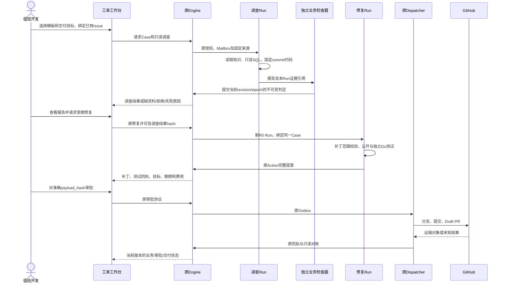

# P0-A：电商工单端到端闭环设计

状态：DESIGN_COMPLETE；接口、表、页面与编排增量均未实施。范围和共同验收见[设计入口](README.md)。

## 1. 用户、业务范围与交付

用户为现有单项目/仓库配置下的值班开发和技术支持。入口问题示例：“昨日订单日报收入高于实际收款，请核对口径并提出修复建议。”

P0仅注册三种任务模板，不引入开放式意图分类：

| 模板 | 问题与预期调查 | 允许修复 |
|---|---|---|
| duplicate_paid | 同一order_id有多条paid事件；分别核对事件金额和去重金额 | 同一Go纯函数内实现已批准的去重口径 |
| status_filter | pending/cancelled记录被计入收入 | 同一函数内保留paid过滤 |
| refunded_status | 已全额退款、标记refunded的记录仍进入报表 | 同一函数内排除非paid记录 |

退款场景沿用现有orders.status，不接入退款流水表。部分退款、币种换算、跨表关联不属于此切片。没有原始凭据、用户真实订单或生产写权限。

交付目标二选一：`report`为校验通过的站内调查报告；`draft_pr`为在报告基础上通过测试、经人工审批并核对远端完整对象的Draft PR。报告发布成Issue评论是独立Action，不作为本切片默认动作。外部Issue由用户事先建立并绑定；不让模型自动创建业务Issue。

## 2. 工单对象与原有权威

业务Case是原Thread的关联信息，不替代Ticket/Run。一个(project, repository, issue_number)最多一个当前Case，Case revision随范围/业务口径/来源版本变化而增加。

- 原Thread保持每个Issue最多一个active primary。
- 调查Run用R4图和只读scope；引用关联本Run实际读取的知识、SQL、代码证据。
- 调查结束释放primary后，用户请求修复且独立修复许可有效时，在同一Thread创建新的R5 Ticket/Run。
- 两个Run通过Case和不可变investigation_result_hash关联。修复Run不得将调查Run的evidence_id冒充自己的读取；必须通过原工具重新读取/登记可用来源。
- 原Engine持锁PG连接为唯一全局写者。LangGraph只管理单Run流程，Redis只作可重建缓存。

调查→修复必须检查无active primary；否则返回409 CASE_STAGE_BUSY，不能把修复请求作为普通follow-up误投给调查Run。创建Run与Case关联在同一Engine事务内完成，原Repairs.create要求route=created的约束继续保留。当前create入口先读取snapshot/写CAS，实施时须拆出prepare与SQL-only提交段，不能直接把整个现有入口套进外层事务。

## 3. 端到端顺序

所有网络、SQL数据源查询、Docker编译、CAS写入位于Engine业务事务之外。流程箭头不表示将外部调用放进持锁事务。

## 4. 数据口径与来源一致性

合成数据固定为现有五列`event_id, order_id, status, amount, created_at`。amount为CNY元的有限Decimal字符串；Go适配器以精确乘100转换为整数分，不能浮点近似、静默舍入或超出Go int安全测试范围。

采用[合成口径与三个数据集](fixtures/commerce.json)：

- 只统计UTC窗口[start,end)内status=paid记录；工作台按Asia/Shanghai显示窗口，保存时带时区。
- 相同order_id的paid事件按最小event_id确定唯一记录；只有paid金额一致时才按此口径去重，冲突金额返回needs_input，不任取记录。
- pending/cancelled/refunded均不计收入。此处refunded是一条已明确标记的全额退款记录，不推断其他paid记录后来发生退款。
- 事件总额、去重总额、全部状态原始总额各自具名，不能把“事件行数”写成“订单数”。空集合金额为`0.00`，负金额或超出本口径的币种/状态先阻断。

同一调查必须绑定知识snapshot/version、数据fixture_hash、GitHub commit/tree/blob、task spec hash与实际观察回执。多次SQL调用使用同一不可变合成数据集；单条查询的REPEATABLE READ不能被描述成跨连接共享快照。数据hash或来源变化即停止旧版本结论，创建新Case revision后重新读取。

SQL继续由原封闭AST策略和只读角色执行；查询模板由服务端选择、schema由profile提供，不接受网页或模型直接拼接标识符。新模板只使用原orders单表允许语法。模型不能提供DSN、凭据或目标仓库。

## 5. 任务输入与交接契约

完整输入为[task.schema.json](contracts/task.schema.json)。它是服务端规范化、授权绑定后的Case spec，不等同允许浏览器自报actor/权限的请求体。[设计样例](examples/tasks.json)只用合成数据。

Case spec包括：项目/仓库/已有Issue、actor、Case revision、模板、目标、UTC窗口、知识/数据/代码锁定引用、公开接受规格hash、调查许可引用和独立修复许可引用。所有profile引用必须由服务器查到有效许可，spec本身不给权限。

Case spec/hash和数据hash沿用原digest的规范JSON（UTF-8、键排序、紧凑分隔符、无NaN）；源码与引用单元使用原始字节SHA256。幂等键属于入口请求记录，不参与已经规范化的业务规格；同一键仍校验完整请求hash。HTTP创建请求仅含template_id、已有issue_number、window、goal和client_request_id，身份/来源/许可均由服务端解析。

调查→修复交接要求：

1. 当前调查business_result=passed，且Case revision/input revision仍匹配。
2. 用户实际请求了draft_pr目标；不存在进行中的调查或其他primary。
3. 重新核对原权限、知识ACL、来源hash、GitHub基础commit/tree、修复范围、到期、预算及未知调用。
4. 修复许可精确匹配Case仓库、Issue、源码commit、路径、函数和独立预算。不能借用调查模型剩余额度，也不能把只读Mandate原地升级成写权限。
5. 事务外完成原R5取码与snapshot CAS准备；短事务内校验预期Case revision/调查结果hash/active primary，复用拆分后的原R5 SQL-only创建段并追加关联，写入时重核全部绑定。原create公开入口调用同一准备/提交实现，不能产生第二套修复协议。
6. 基础代码不匹配时返回SOURCE_CHANGED，要求新版本调查或显式确认新范围；不偷偷rebase。

用户编辑补丁沿用原R5“取消旧Action、增加输入版本、重新测试/审批”流程。统一结果投影必须即时显示旧验证不适用于新输入；见[P0-B](02-business-result.md)。

## 6. UI与API草案

复用原本地Token认证、现有工作台、SSE和GitHub webhook入口，不新增登录/多租户系统。

工作台包含：工单列表（模板、窗口、当前业务/交付状态）、工单详情（来源锁定、时间线、后续消息、差异金额）、结果与提案区（结构化事实、引用、未验证假设、缺资料、diff/测试/审批/PR链接）。unknown显示对账入口，不能显示“重新发送”按钮；已交付的旧PR在新版本产生后仍保留在时间线。

以下均为**拟新增**接口，不声称当前API已实现：

| 方法与路径 | 行为与复用 |
|---|---|
| POST /api/v3/commerce/cases | 根据注册模板建立Case并调用原事件/调查入口；client_request_id幂等 |
| GET /api/v3/commerce/cases | 当前授权范围内列表；状态读取P0-B投影 |
| GET /api/v3/commerce/cases/{case_id} | 返回spec引用、Run链接和版本信息 |
| GET /api/v3/commerce/cases/{case_id}/result | 返回原执行/Action状态与独立业务结果投影 |
| POST /api/v3/commerce/cases/{case_id}/messages | 使用原Run消息/Mailbox；变更口径显式升Case revision |
| POST /api/v3/commerce/cases/{case_id}/repair | 传expected_case_revision、investigation_result_hash和幂等键；原R5创建协议 |

已有`/api/v3/runs/{run_id}/repair`、原R5审批/编辑/拒绝、原Run控制和事件SSE继续复用。新Case接口从可信会话/profile解析actor、project和repository，再逐项验证绑定；客户端只能请求，不能声明授权。

messages请求包含body、client_request_id和expected_case_revision。调查阶段普通消息沿用Mailbox并使Run input_revision推进；范围/窗口/来源变化必须显式提交结构化变更并增加Case revision。修复阶段的补丁编辑走原R5接口；改变业务口径的消息使旧提案失效，取消未发送动作，待旧primary结束及未知核清后才能以匹配许可重新调查。不能把普通聊天强行投给不支持R2 intake的R5图，也不能自动升级或重置许可。

## 7. 存储草案与一致性

未来用显式新迁移增加以下Engine所有的附加记录；本次没有迁移文件或数据库操作。

- `app.commerce_cases`：case_id、唯一(project,repository,issue)、thread_id、current_revision。只保存关联与版本指针，不复制Run/Action状态。
- `app.commerce_case_specs`：主键(case_id,revision)，不可变spec_hash→原CAS Artifact、创建事件ID。
- `app.commerce_case_runs`：主键(case_id,revision,stage)，关联run_id、绑定input_revision、preceding_result_id；同一调查Run在后续版本可产生新的关联行，不能用UNIQUE(run_id)阻断正常追加输入。
- `app.business_results`与当前结果索引：定义见P0-B；终态历史记录不更新，只用当前版本指针选择适用结果。

case创建/版本推进/Run关联/结果提交均采用expected revision的条件写及原epoch防护。先存不可变CAS再提交索引；事务失败留下未引用Artifact可后续按原策略处理，不可先发外部动作。

## 8. 异常与恢复

| 触发 | 必须行为 |
|---|---|
| 相同幂等键与相同请求 | 返回原Case/Run/Action，不再调用模型或创建PR |
| 相同键不同内容 | EVENT_ID_REUSED，不能覆盖 |
| 新资料/口径追加 | 原Mailbox intake/replan；旧结果标为不适用，新版本重新检查 |
| 证据缺失/数据冲突 | needs_input与具体缺项；不启动修复 |
| 权限撤销/越权请求 | denied，避免返回已撤销材料；不启动修复/发布 |
| 预算不足/未知模型结果 | 原预算护栏；未知保留预占并停止，不重发 |
| 测试失败/隐藏用例失败 | 保留候选与原失败回执，不能进入可审批发布 |
| 人工拒绝/取消 | 原控制协议；晚到回执只记账，不恢复任务 |
| Draft PR回执丢失 | 原outcome_unknown及只读精确对象对账；不重复发布 |
| 进程崩溃 | 原Engine恢复规则；已知有效结果复用，旧epoch被拒绝 |

## 9. 实施与验收边界

实施文件预计限于新增commerce关联层、原API/工作台适配、原Engine方法与显式迁移。不能直接改写全局调度、R4工具权限、R5沙箱/审批/发布协议或旧实验目录。

验收先做受控模型真实PG/Redis/Go，再冻结真实模型+GitHub目标。三个正常场景分别判定报告、补丁与Draft PR；两个负例验证缺资料/撤权；重复、后续输入、编辑与未知恢复另列工程验收。全部阶段必须用同一Case revision的证据和提案。见[验收矩阵](acceptance-plan.json)。

只有受控工程与独立真实闭环都达到预定门槛，才能将P0-A实施标为完成；不能用旧R4/R5分开通过的记录代替这次整合验收。
