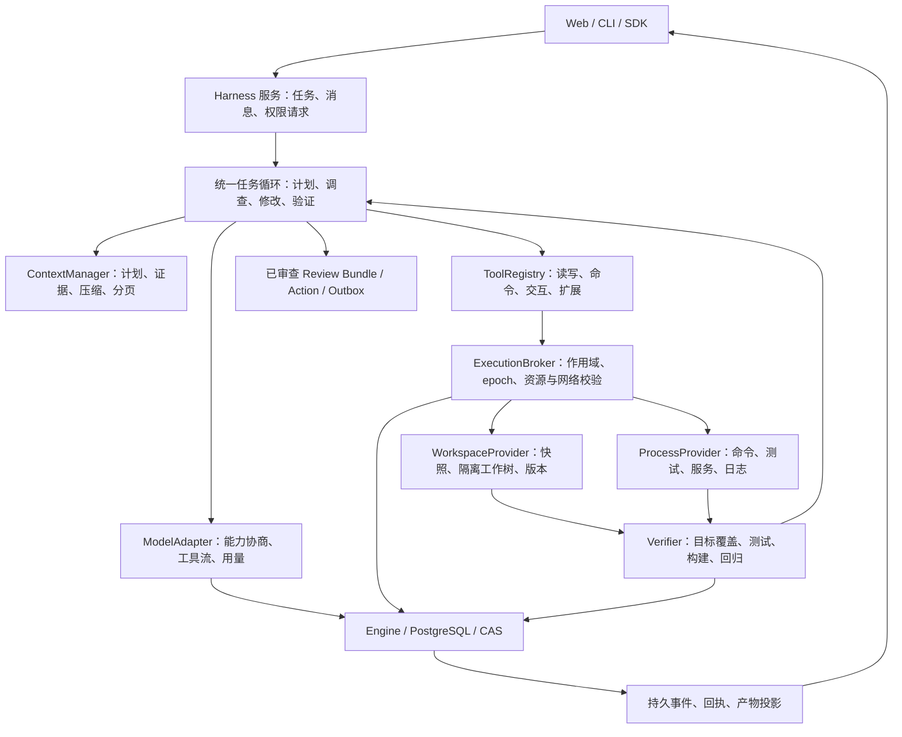

# Harness V4 架构与升级路线

状态：PLANNED。基线与现状见 [总览](README.md)，具体交付见 [任务书](TASKS.md)。
`quality_eval` 中已有的“评测 Harness”负责实验运行与评分；本轮要建设的是服务用户
任务的编码运行时，两者通过回执与评测接口连接。

## 1. 产品目标与首版边界

用户体验目标：选定项目，描述“增加健康检查接口，补测试并保证现有测试通过”，
然后在同一会话看到调查、改动、测试、失败后的修复和最终 Diff。用户无需安排
模型轮数或手工把源码、错误日志往返粘贴给模型。缺少必要信息或权限时才提出具体
问题，已有范围内的编辑与测试连续进行。

MVP 面向单机管理员，覆盖 Linux/WSL、Python 与 JS/TS 小中型项目，保留现有 Go
适配的兼容测试。输入包括 GitHub URL 和明确注册的本机项目；输出包括真实工作树
变更、Diff/补丁、测试与执行回执、未完成项和费用。首页保留只读分析模式。

后续按需求增加 SDK、Skills/MCP、远程 Runner、多用户、IDE/ACP、桌面打包与子 Agent。
任意语言、任意依赖、任意时长与所有项目的成功率不属于首版承诺。

## 2. 推荐架构

图中的 Harness 服务和统一循环是组合/调度层，业务字段继续由现有 Engine 授权事务
写入 PostgreSQL。LangGraph 保管单 Run 执行状态；Redis 仍为可重建缓存。部署可以
替换 ModelAdapter 与执行 Provider，权限、费用、审批与最终完成状态始终经过固定入口。

### 2.1 复用、扩展和新增

| 处理 | 组件 | 原因 |
| --- | --- | --- |
| 直接复用 | Engine、预算预占/结算、CAS、Action/Outbox、Review Bundle、账户会话、SSE 游标 | 已有明确权威和恢复协议 |
| 适配后复用 | RepoAnalysisAgent、工作区快照、PatchWorktree、RepairAgent、SandboxExecutor、ContextBuilder、Memory、Verifier | 各自能力有边界，需要公共契约和编码任务接线 |
| 新增薄接口 | ModelAdapter、ToolRegistry、Workspace/Process Provider、ExecutionBroker、任务验收清单 | 让不同工具/模型共享执行与权限路径 |
| 扩展产品面 | 项目选择、Diff/日志、运行中指示、权限动作卡、产物交付 | 当前首页尚不覆盖完整编码活动 |
| 分阶段增加 | 插件/SDK、远程 Runner、项目 ACL、按需子 Agent | 依赖核心闭环和真实能力证据 |

### 2.2 状态与事件契约

H01 应冻结以下映射及迁移方法，而不是再建立一套互不相干的 Session 数据库：

- 会话以现有 Thread 为基础；一次明确任务/追问绑定 Run 和预算，步骤使用 operation_id
  与 execution_epoch。Task/Finding/Approval 保持现有业务归属。
- 计划、验收项、目标修订、工作区版本、命令句柄与工具结果通过版本化事件和检查点
  关联；授权和用量事实在 Engine 中，检查点或模型总结不能替代它们。
- 典型事件：user_message_received/applied、plan_updated、tool_started/completed、
  command_output、patch_applied、verification_result、permission_requested、artifact_ready。
  事件附 run/operation/epoch/revision/cursor；大日志用 CAS 分段引用和分页读取。
- 客户端视图由持久事件与最终结果投影生成。浏览器刷新、SDK 订阅和 CLI 重连看到
  同一任务，不各自维护“已修好”状态。公开文字、命令与变更流和内部模型推理分开。

### 2.3 工具与执行环境

第一批工具以实际任务需要为准：读取、列目录、搜索、查看 Git 状态、增量编辑、
执行/查询/取消命令、读取日志/产物页、更新计划、请求用户信息。测试适配器决定
哪些回执可用于“测试通过”；普通命令退出 0 不自动提升为任务验收通过。

文件和进程 Provider 必须指向同一个执行世界。不能让模型在服务器读一个快照，
却在用户原目录执行另一份代码。依赖准备与任务进程分别隔离；只有准备阶段能在
获准源下载所需包，项目运行时网络按任务能力限制，凭据不进入项目环境。

本机项目先在隔离工作区工作，原 dirty/untracked 改动完整记录。最终应用回原目录
需要 pre-image 一致；冲突时保留候选 Diff，由用户选择处理。禁止无提示地 reset、
覆盖或自动丢弃用户改动。

### 2.4 执行策略与验收

分析与编码使用同一资源策略：Token、费用、上下文、时间、进程及输出资源共同约束。
内部防循环根据验收缺口、失败签名、证据与版本变化判断；有实质进展时继续工作。
重试明确区分已知未执行、已知失败、结果未知，未知付费/外部操作仍先对账。

验收依据任务类型组合：需求行为测试、构建、类型检查、回归、固定源码引用或服务
就绪。模型负责整理目标和解释结果，最终完成声明必须有相应类型的有效回执；
第二个模型说“通过”只能作为评审意见，不能代替测试或独立判定器。

运行中指示进入持久收件箱，在工具/模型安全点应用并增加目标版本。旧回复仍须
正确结算费用，但不能在目标或 epoch 失效后继续编辑/执行。暂停、取消、等待授权
和结果未知使用可区分的状态与恢复动作。

## 3. 是否直接采用 DeepSeek Harness

| 路线 | 可获得的能力 | 接入成本与待验证项 |
| --- | --- | --- |
| A：现有 Python 内核加公共端口 | 最大程度复用 Engine、修复和测试；业务兼容与权限入口直接可控 | 通用工具、进程、流式协议与扩展生态需要自行完成 |
| B：DSH 作为可替换执行后端 | 借用其 Agent Loop、工具/模型插件、会话与多入口机制 | Node/SDK 运行时、版本兼容、状态投影、所有调用的预算/权限拦截、恢复与凭据边界都需验证 |

推荐先保持 A 的权威结构，同时用 H01 的限时验证评价 B。采用 B 的放行条件：

1. 每笔请求可以在发送前由现有账本预占，并在已知/未知结果下正确结算。
2. 所有工具和项目进程均经过能力入口，扩展不能拿宿主凭据或直接发布。
3. 可将 DSH 会话投影到现有 Task/Run/epoch；DSH 本地事件不另行裁决业务成功。
4. 取消、失联、重启可恢复；契约版本、许可证和依赖固定，故障有可复现记录。

选择 B 不意味着移除 PostgreSQL 或放弃已有审计；选择 A 也不要求复制 Cordis 的
整个 TypeScript 插件系统。正式 ADR 记录选择和未采用路线的原因，避免长期维护
两套默认执行内核。Codex/Claude Code 可作为产品/工具协议参照，不把其 UI 外观当
作接入其运行时或获得其模型能力的证明。

## 4. 里程碑与放行条件

| 阶段 | 卡片 | 能交付什么 | 放行条件 |
| --- | --- | --- | --- |
| M0：基线与选型 | H00–H01 | 可复核基线、首批任务、公共契约、DSH 复用决策 | 检查基线清理；接口/权威映射和受控样例通过 |
| M1：最小编码闭环 | H02–H08 | 同一首页真实读/改/执行/验证、Diff 与产物 | 隔离执行与浏览器工程链路通过；标明 live 是否已执行 |
| M2：可验收 MVP | H09–H12 | 运行中协作、长上下文、完整恢复及真实任务成绩 | 安全与工程门通过；真实模型/Agent 达到冻结门槛 |
| M3：可复用产品 | H13、H14、H18 | Headless/SDK、扩展机制、可安装升级与诊断 | 各入口一致，扩展不绕过策略，安装/升级/恢复实测 |
| M4：部署与协作扩展 | H15–H17 | 配对 Runner、多用户隔离、可选按需子 Agent | 设备/租户隔离、并发故障验证；子 Agent 有独立收益证据 |

M1 可作为内部试用版本；M2 是声明本规划范围内编码 MVP 可用的门槛。GitHub 发布
独立验收，不影响只在隔离工作区编码的 MVP；发布未执行时明确标记 NOT_RUN。
桌面/IDE 客户端可在 M3 之后另立卡，复用已稳定协议，不阻塞最初的编码闭环。

## 5. 排期估算

| 范围 | 净人日估算 | 说明 |
| --- | --- | --- |
| M0 | 3–5 | 基线与限时选型 |
| M1 | 19–28 | 模型/工作区可并行，编辑/执行可并行，编排在两者之后 |
| M2 | 11–16 | 收件箱与上下文可并行，恢复和最终评测串行收敛 |
| M0–M2 合计 | 33–49 | 不含跨卡余量、真实模型预算等待和不可预见环境差异 |
| M3 | 7–13 | SDK、插件、可安装发布 |
| M4 | 11–17 | 含可选子 Agent；去掉 H17 则为 8–12 |

M0–M2 建议再预留约 25% 集成与缺陷修复量，即约 41–61 人日。按每周 5 个工作日，
一名工程师约 9–13 周；两名熟悉代码的工程师约 6–9 周，受串行依赖约束，不简单
除以二。上述是初始工作量估算，不是交付日期承诺；H01 后根据复用结果和 H00 的
基线问题重新估算。后续可以按卡交付，不必等全部路线完成才试用。

建议第一次实施批次只承接 H00、H01：先清楚现有代码和契约，再决定新增量。随后
优先打通单 Agent 的真实编码路径，并及早跑大文件小修改、绿色基线新增功能和
实际依赖环境三类任务，避免再次到最后才发现输出协议或执行环境不适配。

## 6. 主要风险与处理

| 风险 | 对应处理与判定 |
| --- | --- |
| 模型能力弱于任务难度 | 固定模型版本与任务，记录失败类型；适配器可替换，预算耗尽诚实停留未完成 |
| 环境依赖比修代码更复杂 | H06 提供可复现准备阶段与失败回执，先限定语言/平台，不静默使用宿主环境 |
| 大文件输出/上下文耗尽 | H05 增量编辑；H10 按需分页和不变量压缩，分别测累计预算与单次窗口 |
| Agent 修改测试/条件以冒充成功 | H07 冻结验收要求；H12 独立持出判定器，测试修改列入 Diff 和审查 |
| 插件/项目代码扩权或泄露凭据 | H04 实际隔离与能力入口；H14 固定版本、限制扩展能力 |
| 崩溃后重复付费或重复执行 | H11 按操作类别恢复和对账，未知结果不盲重试 |
| 界面完成但底层能力未接线 | H08 从首页驱动真实工作区/沙箱；回执与用户结果共用权威状态 |
| 过早投入多 Agent 和大规模部署 | 以 M2 质量门为前置，再用 H17 对照结果决定默认配置 |

本阶段只提交设计文档；没有改变服务运行方式、开放写能力、启动新实验或发布环境。
