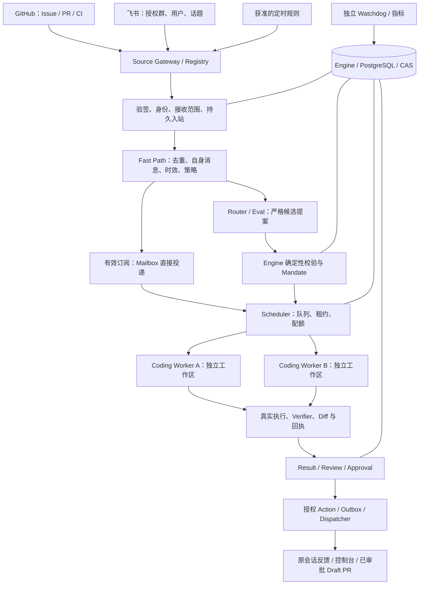

# Super-Agent 架构、数据与权限契约

状态：PLANNED。下列对象、字段和接口为待实施设计，不是当前 API 已支持的格式。
实现卡见 [任务书](TASKS.md)，部署见 [运维方案](OPERATIONS.md)。

## 1. 运行拓扑与权威



Source、Router、Scheduler、Worker 和 Channel 都向 Engine 提交命令或回执；它们不
自行写 Ticket/授权/费用/完成状态。控制器保持一个有效 Engine 写者；执行进程可
独立扩展。PG 是长期状态，Redis 只用于唤醒、短期限流和缓存。断开 Redis 不丢任务。

Router 负责新任务候选、关联与任务层协调。Harness 负责单 Run 的工具循环；Router
不为每个编辑/测试决策再调用一次模型。多个独立 Ticket 可以各自有 Worker，不要求
先实现 Harness 的多角色子 Agent。

## 2. 领域映射

| 对象 | 定义和唯一归属 | 扩展重点 |
| --- | --- | --- |
| SourceInstance | 一次平台安装/机器人身份和它的能力 | 租户、安装、凭据引用、接收范围、能力与健康 |
| SourceEvent | 通过来源校验的规范事件及传输接收凭证 | 先持久接收，再关联业务；拒绝事件只留最小元数据 |
| Trigger | 经作用域校验、可用于路由的业务输入 | 事件来源、版本、强度、策略版本；兼容旧 TriggerInput |
| SourceThreadRef | 平台侧会话、原生话题、回复关系 | 与 MAGR Thread 的映射，不能把群 ID 当唯一任务 ID |
| Thread | 一个可关联问题的上下文与事件序列 | 保留现有主键，增加版本化源关联 |
| Ticket/Task | 目标、生命周期、验收项和业务结果 | 同一问题的多轮执行，而非每条消息新建 Agent |
| Mandate | 哪条明确请求/团队规则授权了哪些工作 | 来源、actor、policy、仓库、路径、能力、预算和有效期 |
| Subscription | 某任务订阅某话题的输入用途 | primary/context_only、TTL、交回、取消与最后消费游标 |
| Assignment | 一个 Ticket/Run 当前由谁执行 | Worker Session、工作区、lease、epoch、心跳和资源 |
| Run/Job | 实际模型/工具执行及异步进程 | 复用 Harness，绑定代码版本、输入 revision 和预算 |
| Channel/Delivery | 向哪里发送什么结果，实际是否收到 | 通知授权、内容 hash、Action/Outbox、外部回执/未知状态 |
| RecallLink | 对上述对象的有类型引用 | 来源与权限逐跳检查，引用不等于可读权限 |

现有 Thread/Ticket/Run/Subscription/Outbox 保持业务归属。可以新增来源安装、身份、
接收凭证、关联边、分配租约和投递回执表；不能复制一套 SuperThread/SuperTicket。
未确定仓库或话题的消息先进入受控来源收件箱，不用虚构 issue_number=1 绕过旧模型。
新增字段通过前向迁移接入，旧 GitHub/CLI/Web 输入继续兼容。
旧/新来源管道灰度切换时，每个安装/事件范围只有一个启用的业务入站所有者；
Shadow 旁路只观察，不能让同一 Webhook 同时经两套入口创建任务。

### 2.1 建议的 SourceEvent v1

```json
{
  "schema_version": "source-event-v1",
  "source_kind": "feishu",
  "source_instance_id": "fs-install-1",
  "tenant_id": "tenant-1",
  "delivery_id": "delivery-123",
  "remote_event_id": "event-123",
  "entity_id": "message-456",
  "entity_revision": "version-1",
  "event_kind": "message.created",
  "conversation_id": "chat-789",
  "source_thread_ref": "topic-012",
  "reply_to_entity_id": null,
  "sender_ref": "feishu:tenant-1:open_id:opaque-id",
  "sender_kind": "human",
  "addressed": "mention",
  "occurred_at": "2026-11-10T10:00:00Z",
  "received_at": "2026-11-10T10:00:01Z",
  "repository_hint": null,
  "body_ref": "<scoped-artifact-reference>",
  "verification_ref": "<verified-source-receipt>",
  "historical_backfill": false
}
```

身份和安装来自已校验平台事件与 Source 注册，不能由正文提供。飞书等 opaque ID
保持原样；GitHub 的规范化仅在对应适配器执行。显示名、正文 @ 文本和模型推测不能
把两个平台用户自动认作同一授权人。

去重键至少包含来源种类、安装、租户、事件类型和外部事件 ID；传输 delivery、实体
message/issue、编辑版本分别记录。同一传输 ID 的不同正文是冲突；同一消息的新
编辑是新版本，不应被旧去重吞掉。来源没有稳定版本时，由受信适配器提供可复核
替代键并标注能力限制。

## 3. Source 能力和可靠入站

SourceAdapter 声明配置 schema、身份/范围、健康、事件规范化、校验、上下文获取，
以及独立 Channel 的发送/查询能力。至少声明：是否有历史读取、增量游标、断线
重放、删除/编辑事件、平台幂等发送和发送结果查询；缺失能力不得默认视为具备。

入站顺序：

1. 平台验签/认证、时间/重放检查，核对 SourceInstance 与真实租户/机器人身份。
2. 先做确定性的接收范围检查，正文和附件按最小需要获取、脱敏和持久化；不在范围
   内的内容不送模型、不进入 Recall，拒绝审计不保存无关正文。
3. Engine 持久提交接收凭证/来源游标后，才能按适配器能力确认接收；之后异步路由。
4. 如果 SDK 的 ACK 顺序不可控制，必须证明平台重放或受限加密传输日志的恢复能力。
   传输日志只用于补交 Engine，不裁决任务；不能仅依靠内存回调就承诺不丢事件。
5. 断线后补拉仍需当前接收权限。无法重放/补拉时记录 gap 区间和影响，不编造历史；
   旧消息默认 context_only，批量补拉不自动触发一批历史修复。

GitHub 优先使用 GitHub App 安装身份、验签 Webhook 和必要的有界补拉；Issue、PR、
review/comment、workflow/check 事件保留资源和 head SHA 关系。飞书首版只使用机器人
身份及实际授予的消息能力，默认仅 @ 或已订阅跟进；全群接收需平台能力及群管理
授权。具体 scopes、历史能力与 ACK 行为在 SA05/SA06 实测，不从 SDK 安装成功推断。

附件、链接和日志均为外部数据；不自动跟随任意 URL 下载或把平台凭据转给 Worker。
私有仓库的安装读取、Worker 快照、模型上下文和返回渠道需要一致的许可范围。

## 4. 四层策略及自主模式

| 策略 | 控制 | 不随之自动获得的能力 |
| --- | --- | --- |
| ReceivePolicy | 哪个安装、群/话题、用户和事件类型可进入/保留/送模型 | 创建任务、代码写入和群发 |
| AdmissionPolicy | 显式请求、已有任务跟进、团队规则信号何时可形成动作 | 直接执行候选动作 |
| ExecutionGrant | Worker 的仓库/基线、路径、工具、网络、预算与时限 | 新仓库、生产发布和任意信息披露 |
| NotificationGrant | 可向哪个渠道发送哪类内容、频率、有效期与身份 | 以聊天里的“同意”批准任意补丁 |

Source actor 的角色至少区分上下文提供者、请求者、任务控制者和项目管理员。群中
允许读取的消息可以作为证据；修改目标、停止任务或批准发布仍需对应控制权限。
团队规则若允许未被 @ 的信号触发调查，其授权依据是管理员预先签署的规则，并
明确可接受的发送者/自动化信号，不是发言本身隐含授权。

| 模式 | 新事件的自动行为 | 允许外发 |
| --- | --- | --- |
| disabled | 该策略不创建新工作；关闭来源接收由独立开关控制 | 无自动回复，保留管理员必要健康视图 |
| shadow | 完整记录“会忽略/关联/提问/创建什么”；不创建实际 Worker/Ticket 副作用 | 不外发、不发布 |
| auto_investigate | 在已授权范围调查、读取与核验 | 按通知许可发送可用结论/必要提问 |
| auto_repair | 在隔离工作区复现、修改和验证 | 按通知许可给出已验证补丁及审查请求 |

Shadow 可以调用获准的 Router 模型，因此也要记录实际费用；未配置路由预算时仅做
确定性观察，并明确“语义评估未运行”。模拟动作/费用不计为真实执行结果。MAGR 的
shadow 明确包含显式请求，避免与参考原型 observe 模式中显式请求仍执行的语义混淆。

普通读写与测试在 ExecutionGrant 内持续进行。新增能力、需要业务澄清、费用/时限
不足或 Review Bundle 审批时才出现具体动作卡。政策修订产生新版本，旧授权不可被
LLM/Memory 扩大；撤权使新操作和待发通知失效，在途操作按一致性规则收尾。

### 4.1 通知和发布的授权记录

常规通知可以由管理员预先授权“向指定原会话发送经核验结果/必要提问”，并限定
模板、内容类别、接收者、频率和有效期。Engine 校验后为实际内容 hash 建立可审计
的策略审批记录，再入 Action/Outbox；不是让模型给自己批准消息。

Draft PR 首版仍需人审具体 Diff/tree/payload_hash，使用原 Review Bundle 和发布协议。
IM 的普通文本“同意”不作为任意补丁审批；首版在已认证控制台完成审查。如后续
支持平台按钮，必须核验平台回调、绑定身份、一次性 nonce、哈希、有效期和当前权限。
自动建 PR 的委托策略、合并和生产部署须另立范围，不包含在 auto_repair 的含义中。

## 5. Fast Path、Router 与订阅

Fast Path 先检查接收/当前权限、重复、失效事件、来源 gap、自身消息、年龄、已订阅
关系和冷却配额；可验证的管理员暂停/撤权通过高优先级控制路径执行。无关事件
直接记最小理由，不需要每条都调用模型。合格事件按话题合并，避免同一段讨论多次
扣费；原始事件身份、顺序与引用保持可查。

Slow Path 只输出有 schema 的候选：ignore、observe、attach、create、ask，以及有权限
和明确目标的控制/交回候选。它不能调用 Shell、直接发送消息或写入业务结果。
Engine 重新检查 policy/revision/epoch、actor、仓库、预算和候选资源后才生成决定。
不确定的仓库/任务归属进入观察或低打扰澄清，不能随机选择仓库开工。

订阅直通只省略“是否创建新任务”的模型评估，不省略当前读取/指令/执行权限检查。
context_only 的 CI、机器人和旁观者内容不能变成新的授权；来源 actor 有效的任务
控制指令才更新约束。每次投递绑定 source event ID、输入 revision 和消费状态。

动态订阅提供 TTL、最后消费游标、primary/context_only、unsubscribe/handback 和关闭
原因。平台原生话题缺失时按明确资源引用/已有候选关联，不能把一个群的所有问题
合成一个 Thread。已结束任务的状态查询可读取获准结果；重新执行创建新的 Run/
Assignment 并重验当前许可、原目标、代码版本及共享余额。已撤销任务不会因任意
成员或机器人消息自动复活。

## 6. 分配、异步执行与结果

Scheduler 事务性领取持久任务，绑定唯一有效 Assignment lease、epoch、workspace、
Run 与队列优先级；控制器失联不能让两个 Worker 共享同一写租约。公平调度覆盖
项目/来源/用户，防止高频 CI 抢占所有槽位。可重建队列缓存不作为领取事实。

Worker 在 Harness 提供的隔离工作区和进程 Provider 内运行。后台测试/命令产生 Job
句柄、日志与完成事件，期间仍可在安全点接受新输入。存在后台进程或子任务时，
相应资源槽位和预算不能被错误释放；等待用户可以释放执行资源但保留任务上下文。
有效订阅首先向当前 Assignment 的收件箱投递或唤醒原 Worker；只有没有有效执行器、
且当前策略允许继续时才进入重新分配，不能每条消息都新开 Session 或槽位。

目标/策略 revision 或 epoch 改变后，旧模型结果仍正确结算，但不能执行旧工具指令。
多文件编辑原子收尾；已发外部操作按已知/未知结果对账。硬撤权拒绝新操作、按策略
停止进程/租约，并核对尚未确认的副作用；“取消”不代表已发生费用自动消失。

只有 Harness 的实际验证回执能提升 patch_verified；疑似原因、证据报告、已验证补丁、
Draft PR 已创建分别展示。PR head/base 改变使旧测试/审批失效，后续 CI 必须绑定
正确代码版本。多个 Worker 的产物通过基线与冲突检查交付，不同时改主分支。

## 7. Recall、通知和数据生命周期

Recall 的主链是 SourceEvent → Thread → Ticket → Run/Job → Evidence/Artifact →
Result/Delivery。检索先按项目、当前身份和来源/仓库范围过滤，再按引用按需分页；
逐跳重验 ACL、内容状态和版本。跨群/项目共享一个标题或内容 hash 不意味着可读取。
设置深度/数量上限、循环检测和失效标记，避免把全天聊天全文塞给 Worker。

通知由确定性的结果和通知策略触发：原话题、当前可读接收者、已达到的验证状态、
安静时段、聚合/去重、冷却、待审级别。私密日志不复制到公开 Issue；跨渠道摘要和
产物链接按目标可见性审查，链接本身也需鉴权，不能携带可复用明文凭据。

Channel 声明幂等键、查询与删除能力。远端接收后丢回执时保留 unknown，支持只读
查证后再结算；没有可靠查证能力就等待操作员处理，不无限重发。自身消息根据
已验证机器人身份、Action/外部回执和来源链识别；CI 及机器人循环有规则、因果链
和冷却上限，不靠正文中一个可伪造的标记判断。

接收撤权、离群、内容编辑/删除触发缓存与 Recall 失效。正文/附件/Memory/CAS 使用
保留期限和作用域访问；需要删除时保留最小无正文审计索引，清理引用/密钥或内容，
不能因 CAS 不可变而永久保留所有聊天。审计完整性与正文留存分别设计。

## 8. 预算与停止边界

Router、Worker、验证、Recall 模型调用及子 Agent 全部计入项目/组织总额；任务预算
是共享余额下的子额度，不为每条事件重置一份可无限累加的钱包。另设来源速率、
候选数、队列长度、活跃槽位和通知量。Token 充足时任务继续，不要求用户配置轮数。

周期预算的时区与边界在策略中冻结；跨日的未知预占继续占用相应全局余额，不能
通过午夜清零退款。无事件/任务时不进行周期性 LLM 空转，定时任务需明确规则。
预算不足进入可见等待，恢复前重验权限和剩余额度；Watchdog 只提交恢复请求，
不能自行扩权、重置费用或把 unknown 判为失败后重发。

## 9. 建议的实现布局

以下是候选位置，由 HV4-H01/SA00 的 ADR 冻结，尚未创建这些实现模块：

```text
src/mgar_v3/
  sources/
    domain.py        # 来源安装、规范事件、ActorRef、能力
    registry.py      # 配置、健康、来源与 Channel 注册
    ingress.py       # 验证后的入站、游标、重放与 gap
    github.py        # GitHub App / Webhook 适配
    feishu.py        # 飞书机器人适配
    channel.py       # 发送/查询能力端口，不直接批准消息
  super_agent/
    service.py       # 组合现有业务服务，统一控制台/API 入口
    policy.py        # 四层策略和模式校验
    scheduler.py     # 由 Engine 事务领取和维护分配
    worker_bridge.py # Mandate/消息/Job 到 Harness 的映射
    recall.py        # 有界引用检索与逐跳鉴权
    notifications.py # 通知计划、披露与 Action 组装
```

`super_agent` 是组合层，不实现第二个 Engine 或独立业务写连接。所有状态提交通过
原 Engine 或它持有同一连接的子服务完成。文件拆分可随 ADR 调整，接口和权威边界
必须保持，避免仅按目录名推断能力已经存在。

| 卡片 | 重点复用/修改位置 |
| --- | --- |
| SA01–SA06 | `domain.py` 兼容入口、`sources/`、`api.py`、Engine 入站、前向迁移 |
| SA07–SA10 | `routing/`、`proactivity/`、`super_agent/policy.py`、共享预算与关联事务 |
| SA11–SA14 | Engine Mailbox/epoch、Assignment、`super_agent/scheduler.py`/`worker_bridge.py`、Harness Broker |
| SA15 | `context/`、`memory/`、Evidence/CAS、`super_agent/recall.py` |
| SA16–SA18 | `proactivity/`、`effects/dispatcher.py`、Workbench/Review Bundle、通知与 Channel |
| SA19 | `web/agent.*`、账户/设置 API、策略与任务状态投影 |
| SA20–SA21 | `deploy/`、`recovery/`、服务启动/恢复、备份/清理与安全验证 |
| SA22–SA23 | `quality_eval/`、注册验收、`scripts/`、部署/升级与公开支持矩阵 |
| SA24 | Source 注册及 Harness H15/H16 的设备/项目边界 |
