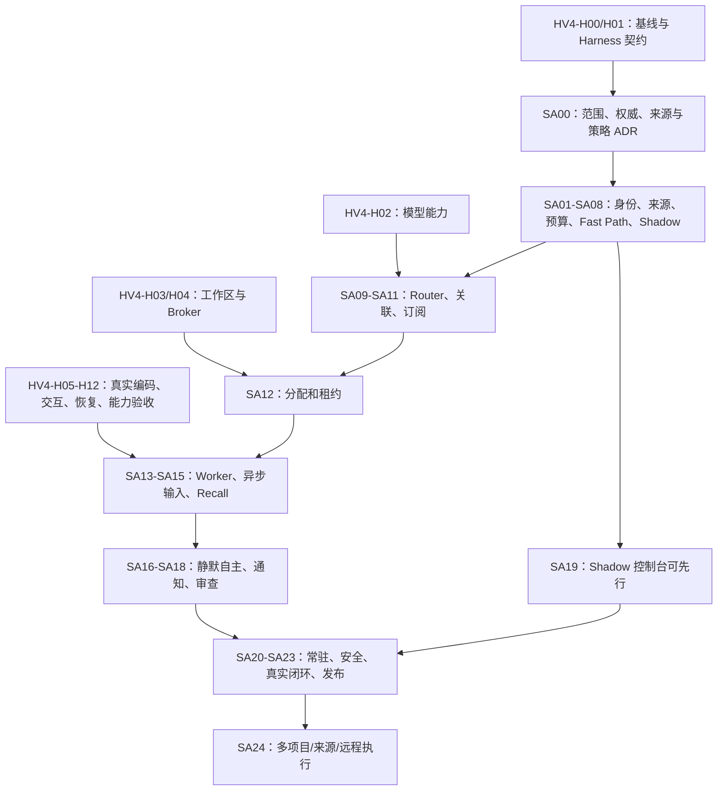

# Super-Agent 与 Harness 的合并升级路线

状态：PLANNED。实际卡和依赖以 [TASKS.md](TASKS.md) 与 [plan.json](plan.json)为准。
完整范围见 [总览](README.md)，通过条件见 [验收](ACCEPTANCE.md)。

## 1. 两条开发轨道，一个业务权威

Harness 轨道解决单任务的真实代码操作；Super-Agent 轨道解决持续事件、任务分配
和回原会话的反馈。两者共用 Engine、业务对象、预算、证据和权限；不能部署两个
分别决定“任务完成/有权执行”的内核。

Source 和确定性 Shadow 不等待整个编码系统完成，适合并行收集误触发与权限问题。
需要模型的语义 Shadow 等 HV4-H02 的预算/适配契约；真实自动修复等 HV4-H11/H12
通过。受控适配器可以先验证接口，但不能提前开放真实修改开关。

## 2. 阶段交付与放行

| 阶段 | 卡片 | 可见产物 | 放行依据 |
| --- | --- | --- | --- |
| S0：范围与权威 | SA00，衔接 HV4-H00/H01 | 复用审计、统一状态/权限映射、首版和验收冻结 | 依赖、历史边界、模式和数据权限明确 |
| S1：来源与观察 | SA01–SA10，SA19 观察视图可前置 | 群/用户/GitHub 设置、来源健康、影子路由与查重 | 幂等/缺口/身份工程门，独立路由集达标；无代码/外发副作用 |
| S2：持续 Worker | SA11–SA15 + Harness 核心门 | 订阅、分配、独立工作区、Job、新指示、Recall | 真实工具与并发恢复；已授权范围内的真实模型能力通过 |
| S3：静默自主 | SA16–SA19 | 按规则调查/隔离修复、低噪声反馈、具体审批 | 四层权限、共享预算、通知回执、目标/版本与审查一致 |
| S4：落地首版 | SA20–SA23 | 在线服务、操作台、故障/数据处置、真实试用、安装交接 | 所声明工程/安全/真实来源/编码/长期运行门通过；发布能力单独说明 |
| S5：扩展 | SA24 + HV4-H15/H16 | 多项目/更多来源/远程 Runner | 按来源/租户/设备独立验收，不继承单群单仓成绩 |

S1 可以作为早期观察版交付，S3 可以在可控测试团队内部试用，S4 才声明已落地到
首版支持范围。若未执行真实 GitHub 发布，保留“生成已验证补丁、等待审批”能力，
对外明确真实 PR 发布 NOT_RUN，不因缺写权限阻塞整个只读/隔离编码版本。

## 3. 前后任务如何复用

| 现有/既定能力 | Super-Agent 使用方式 | 新卡的新增量 |
| --- | --- | --- |
| Engine/PG 及 Thread/Ticket/Run/Mandate | 保持唯一写者和权限权威 | 来源身份、未关联入站、关系、Assignment/租约的版本化扩展 |
| 旧 Router/Subscription/Mailbox | 复用提案/校验/投递和不变量 | 自然信号、Shadow、TTL/交回、跨来源映射与角色检查 |
| 受限 Proactivity | 保留历史许可/预算与已有案例 | 新的团队规则/模式/共享总额，不复用旧许可扩大为代码修复 |
| HV4-H02/H03/H04 | 模型、工作区、执行 Broker | Source 及策略到对应能力/预算的适配 |
| HV4-H05–H08 | 单任务编辑、执行、验证与产物 | 群/事件发起的 CodingWorkerBridge，私有安装令牌快照桥接 |
| HV4-H09/H10/H11 | 交互、上下文、恢复 | 来源消息/控制/Job 接入，Recall 原始引用，持续分配生命周期 |
| HV4-H12 | 编码真实能力门 | 多渠道起点/反馈、长期运行、误触发和通知效果门 |
| 现有 Outbox/审批 | 保持精确内容/提案的副作用协议 | NotificationGrant、飞书/GitHub Channel、聚合与投递能力矩阵 |
| Watchdog/恢复/运维基础 | 复用低权观察、积压、未知保护 | 来源 gap、Assignment/Job、全天运营和真正的隔离故障演练 |
| HV4-H13/H14/H18 后续产物 | 有则复用 SDK、扩展、安装/诊断 | 仅补 Super-Agent 场景；不把局部运维交付算成整张 Harness 卡完成 |

同一实现/测试产物可以被两个验收摘要引用，工作量只计一次。HV4-H17 子 Agent
不是 Super-Agent 的前置；先评价多任务 Worker 的独立执行与交付能力。

## 4. 实施工作包

建议每个工作包包含可验收的完整切片，而不是让执行 Agent 一次实现 25 张卡。

1. **接口与 ADR 包**：HV4-H00/H01 + SA00–SA03。先冻结四层授权、Source 身份、
   状态映射和测试，不开放新真实行为。
2. **来源与 Shadow 包**：SA04–SA10，加 SA19 观察页。可以在 Harness 编辑/执行
   开发期间并行；真实平台权限未配置时使用明确录制样本，真实渠道门仍 NOT_RUN。
3. **Harness 核心包**：HV4-H02–H12。优先验证大文件增量编辑、绿色基线任务和
   实际依赖环境，避免来源链全接通后才发现 Worker 修不了代码。
4. **连续执行包**：SA11–SA15。验证订阅→Mailbox→独立 Run/Job→安全点的持续
   生命周期，与源/目标/策略版本绑定；受控集成可先行，自动开工受能力门约束。
5. **主动与交付包**：SA16–SA19。逐级启用调查和隔离修复，通知与发布分别授权；
   用真实回执及噪声统计验证低打扰。
6. **常驻与试用包**：SA20–SA23。独立进程部署、故障、72h 与团队试用、发行交接。
7. **扩展包**：SA24 及必要 Harness 后续卡。新增来源/项目/设备分别验收，按需引入
   模型子 Agent，不预设它能提高成功率。

## 5. 工作量与日历估算

| 范围 | 净人日 | 说明 |
| --- | --- | --- |
| Super-Agent SA00–SA22 | 44–73 | 含卡内工程验证、试用准备和结果分析，不含单任务 Harness 实现 |
| 首版交接 SA23 | 2–3 | 单仓单群的发行、升级与操作交接 |
| Super-Agent 首版增量合计 | 46–76 | SA00–SA23；不含可选 SA24 |
| Harness MVP HV4-H00–H12 | 33–49 | 沿用上一份规划；相同实现不重复计费/估时 |
| 两份规划首版合计 | 79–125 | 控制层可以并行推进，仍有串行依赖 |
| 可选 SA24 | 3–5 | 另计未完成的 HV4-H15/H16 及其依赖，避免漏算或重复算 |

建议合并首版再保留约 25% 集成与缺陷修复余量，即约 99–156 人日。一名工程师按
5 天/周约 20–32 周；两名熟悉系统、分别推进 Harness 和控制层的工程师约 14–22 周，
受依赖与试用日历限制，不简单除以二。平台安装/权限审批、真实试验授权与数据集
准备可增加日历等待。早期 S1 观察版先交付，不必等整个首版结束才看到价值。

这是功能完整首版的初始工作量估算，不是日期承诺；H01 的复用结果和 SA00 的范围
冻结后重估。若缩为“仅 @、只调查、控制台查看、不自动回复/修复”，可减少首轮
实现量，但必须如实命名能力范围，不能把该观察机器人称为完成整个 Super-Agent。

## 6. 用户粘贴需求的覆盖

| 需求 | 主要卡 |
| --- | --- |
| 指定群/用户、机器人授权和来源筛选 | SA01–SA06、SA19 |
| GitHub Issue/PR/CI、私有安装关系 | SA05、SA10、SA13 |
| Fast/Slow Path、Shadow 与团队规则 | SA03、SA07–SA10、SA16 |
| Thread/订阅/交回、同问题持续跟进 | SA10、SA11、SA14 |
| 独立 Coding Worker/工作区/费用 | HV4-H02–H12、SA07、SA12、SA13 |
| 工具运行期间接收限制和 Job 完成 | HV4-H09、SA14 |
| Chain of Recall、第二天状态查询 | HV4-H10、SA10、SA15 |
| 静默工作、有用结果/审查时通知 | SA03、SA16–SA19 |
| Outbox、精确审批、受控 Draft PR | SA17、SA18 |
| 关机后常驻、Watchdog 和恢复 | SA12、SA20、SA21 |
| 共享总预算、防死循环和不空转 | HV4-H07、SA07–SA09、SA16、SA20 |
| 明确获准的定时信号与有界补跑 | SA08、SA16、SA20 |
| 隐私/安全、真实评测与长期运营 | SA21–SA23 |

## 7. 升级决策点

- **来源选择**：按粘贴需求默认飞书 + GitHub；未取得平台能力不冒充已经监听。
  后续平台通过 Source 契约扩展，不把所有 IM 一次纳入首版。
- **运行时复用**：Harness H01 决定采用现有 Python 端口还是复用 DSH 作为执行后端；
  Super-Agent 的单写者、授权、预算和结果协议保持一致。
- **数据与身份**：一次安装/一个管理员先行，真实成员请求角色独立映射；控制台
  多租户和第二仓库扩大范围在 SA24/H16 验收后开放。
- **自主放行**：Shadow 数据达标再开调查，真实 Worker 门与共享预算通过再开隔离
  修复；通知和发布分别放行。模式/策略改变是可审计配置，不从聊天里自行获得。
- **私有仓库**：首个试用仓库是否私有在 SA00 冻结；若私有，App 读取、模型数据
  外发、受控快照和结果可见性都必须纳入 S2 放行，不只验证 Webhook。
- **上线地点**：需要用户电脑关机后仍执行时，选在线服务器和云端 Worker；只在
  本机执行则明示离线等待。Kubernetes/多租户不是单仓首版的必选前置。
- **质量失败**：精确率、修复或长期运行门未达标时，保留受限模式和失败结果，修复
  后用新候选版本重新验收；不通过降低阈值或丢掉失败任务放行。

## 8. 目前交付状态

本轮产物是审计、架构、任务、运维和验收规划，以及机器可读依赖/来源记录。文档
检查通过只表示链接和计划自洽；没有新增运行时能力、来源安装、外部通知、真实
模型试验或部署成绩。未来实现应从依赖已满足的卡开始，逐卡留下可复核产物。
